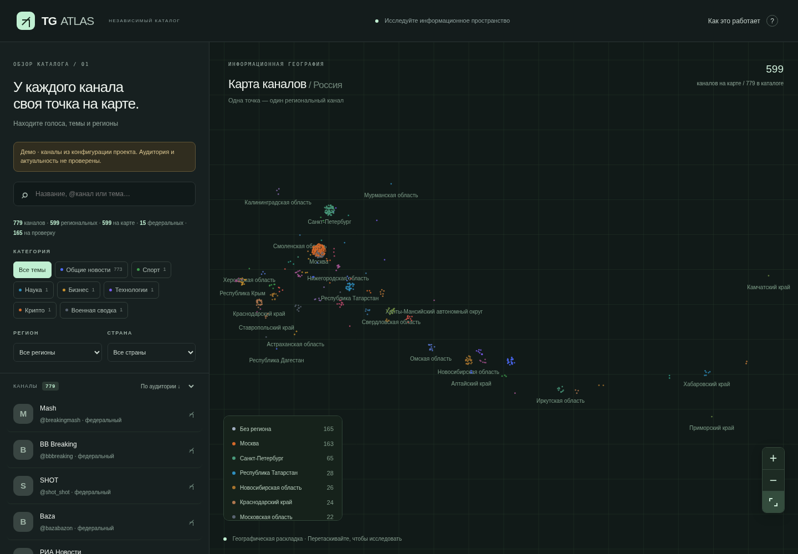

<!-- See FRONTEND.md for the current atlas and incremental polling commands. -->
# TG Atlas — карта Telegram-каналов

Классификация: категория (спорт, политика, новости и другие) → географический охват → регион. Неизвестная география отделена от международного охвата.

Обновлённый интерфейс: органические тематические архипелаги с географическими островами, переключаемым рельефом и контролем расстояний между точками, автоопределение тем с политикой и другими рубриками, ручная корректировка, графитовая тема и мобильный режим.

## Быстрый запуск интерфейса

```bash
python -m http.server 4173 --directory web
```

Откройте http://localhost:4173. Без выгрузки базы используется явно отмеченный демокаталог из конфигурации проекта. Рабочая выгрузка имеет приоритет.

Подробности обновления: [FRONTEND.md](FRONTEND.md).



На карте показаны все каналы, включая каналы без региона. Географическая выгрузка для интерфейса не нужна. Для просмотра обновления откройте [FRONTEND.md](FRONTEND.md).

## Обновление метаданных без Telegram API

```bash
python main.py refresh-metadata --workers 2
python main.py export
```

Обновляются только название, описание и подписчики существующих активных каналов через публичные профили. История публикаций не разбирается и не сохраняется. Для первого импорта исходного каталога используйте `refresh-metadata --from-config --workers 2`. Подробности и первоначальная настройка — в [FRONTEND.md](FRONTEND.md).

## Исходный проект


Версия разработки: **0.7.1**. Это неофициальный сторонний проект, не связанный с Telegram.

Проект собирает открытые сведения о публичных Telegram-каналах из нескольких источников, приводит их к единому реестру кандидатов, проверяет публичную доступность, переносит подтверждённые каналы в PostgreSQL, обновляет метаданные и отображает каталог на географической карте.

> **Ключевой принцип:** внешние каталоги и Telegram-аккаунт только обнаруживают кандидатов. Они не записывают каналы напрямую в рабочую таблицу и не перезаписывают друг друга. Сначала кандидат попадает в `channel_candidates`, а затем проходит отдельные этапы проверки и импорта.

## Что реализовано

- сбор метаданных и доступных публикаций из публичных `t.me/s/<username>`;
- восстановлен прежний поиск tgden через `/api/suggest`; demo-fixture блокируется;
- импорт пользовательского CSV/TSV/JSON-экспорта CloudSeeding;
- read-only MTProto-коннектор через отдельный резервный Telegram-аккаунт;
- импорт публичных broadcast-каналов из собственных подписок аккаунта;
- получение рекомендаций Telegram по подпискам или по выбранным seed-каналам;
- единый реестр кандидатов с источниками обнаружения и дедупликацией по нормализованному username;
- хранение Telegram ID как более устойчивого идентификатора;
- ручной импорт подтверждённых кандидатов в рабочий каталог;
- географическая классификация и геокарта, сохранённые из предыдущей версии.

## Архитектура

```text
                ИСТОЧНИКИ ОБНАРУЖЕНИЯ
       ┌──────────────┬──────────────┬────────────────┐
       │ tgden*       │ CloudSeeding │ Telegram user  │
       │ guarded catalog/suggest │ CSV/JSON │ MTProto │
       └──────┬───────┴──────┬───────┴───────┬────────┘
              └─────────────┴───────────────┘
                            │
                            ▼
               channel_candidates
               channel_candidate_sources
                            │
                     t.me/s validation
                            │
                      candidate-import
                            │
                            ▼
                         channels
                         posts
                            │
               ┌────────────┴─────────────┐
               ▼                          ▼
        region classifier            exporter / geo map
               │                          │
               └────────────┬─────────────┘
                            ▼
                       web/index.html
```

### Назначение таблиц

| Таблица | Назначение |
|---|---|
| `channel_candidates` | Найденные, но ещё не импортированные каналы |
| `channel_candidate_sources` | Все источники, из которых был найден кандидат |
| `channels` | Рабочий каталог каналов |
| `channel_sources` | Происхождение уже импортированного канала |
| `posts` | Доступные публикации каналов |

Один username хранится в `channel_candidates` один раз, даже если найден в нескольких местах. Связи с источниками хранятся отдельно. После получения Telegram ID система предпочитает его для сопоставления сущности, поскольку username может меняться.

## Требования

- Windows 10/11, Linux или macOS;
- Python 3.10+ (рекомендуется 3.11 или 3.12);
- PostgreSQL 13+;
- Node.js необязателен, нужен только для проверки JS-файлов;
- доступ к `t.me` и `tgden.com` либо корректно настроенный HTTP/SOCKS-прокси.

## Установка

### Windows PowerShell

```powershell
# В корневой папке проекта
py -m venv .venv
.venv\Scripts\Activate.ps1
python -m pip install --upgrade pip
python -m pip install -r requirements.txt
Copy-Item .env.example .env
```

Если PowerShell запрещает активацию окружения, выполните в текущем окне:

```powershell
Set-ExecutionPolicy -Scope Process -ExecutionPolicy Bypass
.venv\Scripts\Activate.ps1
```

Создайте отдельную БД PostgreSQL, например `tg_parser_atlas`, затем укажите её параметры в `.env`. После этого:

```powershell
python main.py init-db
```

Команда `init-db` создаёт таблицы и выполняет идемпотентные миграции. При переходе со старой версии сначала сделайте `pg_dump` и только потом выполняйте миграцию.

### Основные настройки `.env`

```ini
PG_HOST=localhost
PG_PORT=5432
PG_USER=postgres
PG_PASSWORD=ваш_пароль
PG_DATABASE=tg_parser_atlas

MAX_PAGES=5
HTTP_PROXY=
HTTPS_PROXY=

TG_API_ID=
TG_API_HASH=
TG_SESSION_NAME=atlas_backup_account
TG_EXPECTED_USER_ID=
TG_PROXY_HOST=
TG_PROXY_PORT=
TG_PROXY_TYPE=socks5
TG_RECOMMENDATION_DELAY=2.0
TG_MAX_RECOMMENDATION_SEEDS=10
```

Не храните `.env` в Git и не пересылайте его вместе с проектом.

## Источники каналов

### 1. tgden

Адаптер использует прежний маршрут `GET https://tgden.com/api/suggest?q=...`, который применялся в ранней версии проекта. Ветка 0.7.x перешла на неподтверждённый `/api/catalog`; в диагностике 03.11.2026 он возвращал одинаковые demo-записи для разных запросов, поэтому этот маршрут исключён. `/api/suggest` — поисковый интерфейс подсказок, а не bulk API и не гарантированная выгрузка всего каталога. Реальный ответ endpoint следует проверять на каждом запуске; demo-fixture не сохраняется. Запросы выполняются по конечному набору тематик и городов из `config/discovery_queries.json`.

```powershell
# Использовать стандартный набор запросов (около 80 тематик и городов)
python main.py discover-tgden

# Или задать свои запросы
python main.py discover-tgden --query "региональные СМИ" --query "автомобильные сообщества"

# Ограничить выдачу на один запрос
python main.py discover-tgden --query "новости Казани" --limit-per-query 20
```

По умолчанию сохраняется не более 20 подсказок на запрос (максимум 100). Между запросами выдерживается пауза 1,5 секунды; запросы не распараллеливаются. Ответ `/api/suggest` обычно содержит только username и название; число подписчиков определяется отдельной проверкой через `discover-validate`. Найденные username попадают в `channel_candidates`, а не в `channels` напрямую.

Содержимое `config/discovery_queries.json` можно редактировать самостоятельно. Наличие города в поисковом запросе **не назначает** этот город регионом найденного канала: региональная принадлежность определяется отдельным классификатором по данным канала и ручным правилам. В каталоге могут возвращаться только верхние релевантные результаты, а не полный список каналов по запросу.

### 2. CloudSeeding

Проект не обращается к закрытому dashboard, не обходит paywall и не использует неподтверждённые внутренние endpoint. Экспортируйте доступные вам данные штатными средствами сервиса в CSV, TSV или JSON, затем выполните:

```powershell
python main.py import-cloudseeding --file "C:\Data\cloudseeding-export.csv"
```

Поддерживаются русские и английские варианты названий колонок для username, названия, категории, региона, страны, подписчиков, охватов, ER и CPM. Исходная строка сохраняется в `raw_data`, чтобы не терять метрики, для которых ещё нет отдельной нормализованной колонки.

### 3. Резервный Telegram-аккаунт (MTProto)

MTProto подключается только при явном запуске соответствующих команд. Наличие резервного аккаунта не отменяет условий Telegram API. До использования для отдельного агрегатора каналов проверьте, допускают ли действующие условия Telegram и применимое разрешение такой сценарий. Условия Telegram ограничивают доступ к пользовательскому контенту целями обычного законного использования платформы и отдельно запрещают использование данных платформы для AI/ML, включая scraping/indexing/aggregation в этих целях. Не используйте полученные публикации для embeddings, тематических ML-карт, LLM-сводок или обучения моделей без предусмотренного согласия/разрешения. См. [Terms of Service for Content Licensing](https://telegram.org/tos/content-licensing) и [Telegram API Terms](https://core.telegram.org/api/terms).

1. Создайте отдельное приложение на `https://my.telegram.org` → API development tools.
2. Запишите `api_id` и `api_hash` в локальный `.env`.
3. Установите дополнительные зависимости:

```powershell
python -m pip install -r requirements-mtproto.txt
```

4. Убедитесь, что `TG_SESSION_NAME=atlas_backup_account`.
5. Авторизуйте именно резервный аккаунт:

```powershell
python main.py telegram-auth
```

При первом запуске Telegram запросит номер, код подтверждения и, если включена, пароль двухэтапной аутентификации. Проверьте выведенный username аккаунта.

После первой авторизации команда выведет Telegram ID пользователя. Сверьте username/ID с резервным аккаунтом и внесите этот ID в `.env` как `TG_EXPECTED_USER_ID`. Пока ID не указан, команды чтения MTProto заблокированы. Это дополнительно защищает от случайного использования чужой/основной сессии.

Сессия создаётся в `sessions/atlas_backup_account.session`. Она эквивалентна ключу доступа к аккаунту: не пересылайте её, не добавляйте в Git и не включайте в архивы. При компрометации завершите соответствующую сессию в настройках Telegram.

#### Импорт подписок

```powershell
# Сначала только CSV-предпросмотр
python main.py telegram-import-subscriptions --limit 500

# После проверки CSV — запись в единый реестр кандидатов
python main.py telegram-import-subscriptions --limit 500 --apply

# Следующая партия: каналы после первых 500 публичных broadcast-каналов
python main.py telegram-import-subscriptions --limit 500 --offset 500 --apply
```

Импортируются только публичные broadcast-каналы с username. Личные диалоги, пользователи, группы и megagroup не включаются. Программа не подписывается на новые каналы. Параметры `--limit` и `--offset` позволяют читать каталог подписок партиями; окно считается только среди публичных broadcast-каналов. По умолчанию создаётся CSV предпросмотра, для записи в PostgreSQL нужен `--apply`. Поскольку канал получен непосредственно из авторизованного списка диалогов Telegram, такие кандидаты помечаются как `validated` и готовы к явному `candidate-import`.

#### Рекомендации Telegram

Telegram предоставляет официальный метод `channels.getChannelRecommendations`: он возвращает публичные каналы, похожие по аудитории. Метод доступен пользовательским аккаунтам; без параметра канала он возвращает общие рекомендации, связанные с каналами, на которые подписан аккаунт. С переданным каналом он требует, чтобы аккаунт уже имел к нему доступ. Метод не имеет пагинации, а Telegram может возвращать урезанный набор рекомендаций обычным аккаунтам.

```powershell
# Общие рекомендации на основе подписок резервного аккаунта — preview
python main.py telegram-discover-recommendations --global

# Рекомендации для конкретного канала, на который аккаунт уже подписан
python main.py telegram-discover-recommendations --seed breakingmash

# Взять до пяти seed-каналов из собственных подписок
python main.py telegram-discover-recommendations --from-subscriptions --max-seeds 5

# Только после проверки preview записать кандидатов в PostgreSQL
python main.py telegram-discover-recommendations --global --apply
```

Предпросмотр сохраняется в `reports/telegram_recommendations_preview.csv`. Повторный запуск с `--apply` добавит кандидатов и связи с исходными каналами в таблицы `channel_candidates` и `channel_candidate_sources`. Поскольку результат получен от официального Telegram API и содержит публичные broadcast-entity, такие кандидаты помечаются `validated`; их можно импортировать в рабочий каталог отдельной командой `candidate-import --apply`.

Важно: для выбранного seed Telegram возвращает рекомендации только если резервный аккаунт уже присоединился к этому каналу. Программа не вступает в него и не пытается обходить это ограничение. Если Telegram сообщает FloodWait дольше автоматического порога, пакет останавливается.

#### Обогащение метаданных и сбор публикаций через MTProto

После импорта кандидатов в `channels` можно точечно обновить название, описание, Telegram ID и число подписчиков:

```powershell
python main.py mtproto-enrich --channel breakingmash
python main.py mtproto-enrich --limit 10
```

Отдельная команда `mtproto-scrape` собирает публикации через авторизованный аккаунт и сохраняет их в ту же таблицу `posts`, что и HTML-сборщик:

```powershell
# Только один канал, последние 50 сообщений
python main.py mtproto-scrape --channel breakingmash

# Два канала; до 30 сообщений на канал
python main.py mtproto-scrape --channel breakingmash --channel baza --messages 30

# Ограниченная партия первых 10 активных каналов из БД
python main.py mtproto-scrape --limit 10 --messages 50
```

За один запуск разрешено не более 25 каналов и 100 сообщений на канал. Команда не вступает в каналы и не отправляет сообщения. Каналы должны быть публичными и доступны резервному аккаунту. На повторном запуске дубликаты сообщений не добавляются благодаря уникальному ключу `(channel_id, tg_message_id)`. FloodWait останавливает пакет; не пытайтесь обходить ожидание увеличением параллелизма.

## Общий рабочий цикл

```powershell
# 1. Обнаружить новые каналы из нескольких источников
python main.py discover-tgden
python main.py import-cloudseeding --file "C:\Data\cloudseeding-export.csv"
python main.py telegram-import-subscriptions --limit 500 --apply
python main.py telegram-discover-recommendations --global --apply

# 2. Посмотреть объём единого реестра
python main.py candidate-stats
python main.py candidate-list --status pending --limit 100

# 3. Проверить публичную доступность кандидатов
python main.py discover-validate --limit 100

# 4. Предпросмотр импорта и фактический импорт подтверждённых
python main.py candidate-import --limit 100
python main.py candidate-import --limit 100 --apply

# 5. Собрать метаданные и доступные посты для активных каналов
python main.py scrape

# Или выборочно получить публикации через резервный Telegram-аккаунт
python main.py mtproto-scrape --channel breakingmash --messages 50

# 6. Обновить классификацию и карту
python main.py backfill-region --dry-run --force --report reports/region-preview.csv
python main.py backfill-region --force --report reports/region-classification.json
python main.py build-geo-map
python main.py export
```

`candidate-import` без `--apply` — только предварительный список. В рабочую таблицу переходят только кандидаты с известным числом подписчиков не ниже `MIN_CHANNEL_SUBSCRIBERS`. По умолчанию порог равен 1 000; его можно изменить в `.env`. `--include-pending` разрешает пропустить проверку страницы, но не обходит минимальный порог и не разрешает импортировать кандидата с неизвестным числом подписчиков. Кандидаты ниже порога получают статус `rejected` с причиной `below_min_subscribers`.

## Команды CLI

```text
init-db                                  создать/обновить схему PostgreSQL
scrape [--channel USERNAME]              собрать публичные страницы каналов из channels
stats                                    статистика каналов и постов
export                                   экспорт каталога для веб-карты
build-geo-map                            перестроить географические точки
build-semantic-map                       отдельный экспериментальный режим

discover-tgden [--query Q]                найти кандидатов в каталоге tgden
import-cloudseeding --file PATH         импорт CSV/TSV/JSON CloudSeeding
discover-validate [--limit N]            проверить кандидатов через t.me/s/
candidate-stats                          статистика реестра кандидатов
candidate-list [--status S]               список кандидатов
candidate-import [--apply]                перенос подтверждённых кандидатов в channels

telegram-auth                            авторизовать резервный аккаунт
telegram-import-subscriptions [--limit N --offset N --apply] импорт подписок
telegram-discover-recommendations         рекомендации Telegram (--seed/--global/--from-subscriptions)
mtproto-enrich [--channel U|--limit N]    точечное обновление метаданных через MTProto
mtproto-scrape [--channel U|--limit N]    сбор ограниченной истории через MTProto
backfill-region                           региональная классификация
```

## Региональная классификация

- `region_hint` — исходная подсказка внешнего источника, например город или регион.
- `region` — канонический субъект РФ, определённый классификатором или ручным правилом.
- `channel_type` — `regional`, `federal` или `unknown`.
- `region_confidence` — эвристическая оценка силы совпадения, не вероятность.
- `region_candidates`, `region_reason`, `region_review_required` — альтернативы и объяснение решения.

Ручные правила находятся в `config/region_overrides.json`, федеральные каналы — в `config/federal_channels.json`.

## Карта

Основной интерфейс — `web/index.html`. После обновления БД выполните `build-geo-map` и `export`, затем откройте файл в браузере либо запустите локальный сервер:

```powershell
python -m http.server 8080 --directory web
```

Перейдите на `http://localhost:8080`. Географическая раскладка привязывает региональные каналы к приблизительным центрам субъектов РФ и не является слоем реальных административных границ.

## Ограничения и ответственное использование

- Сборщик работает с публичными страницами и открытыми метаданными. Он не обходит приватность, paywall, invite-only доступ или защитные механизмы.
- Для внешних каталогов соблюдайте их условия использования и опубликованные ограничения. Не запускайте неограниченный массовый сбор.
- Файл Telethon-сессии и `.env` — секреты. Не публикуйте их.
- Telegram API Terms требуют, чтобы использование API соответствовало обычному, законному и предполагаемому использованию платформы. В Terms of Service for Content Licensing отдельно запрещены scraping, indexing, harvesting, aggregation и использование данных Telegram для обучения, разработки, улучшения, benchmarking или развёртывания AI/ML и подобных технологий. Исключения могут предоставляться только при индивидуальном явном, информированном, утвердительном и продолжающемся согласии всех релевантных пользователей для конкретного содержимого и контекста. Поэтому не используйте собранные через Telegram данные для embeddings, UMAP/t-SNE, LLM-суммаризации, обучения, проверки или inference AI/ML без применимого разрешения/согласия. Команда `build-semantic-map` требует явного флага `--confirm-content-rights`; этот флаг не заменяет юридическую проверку.
- Экспорт CloudSeeding используйте только в пределах прав и условий вашего тарифа/договора.
- Если планируете распространять приложение как Telegram API client, учитывайте требования Telegram к описанию и названию сторонних приложений; в частности, слово Telegram в названии приложения допустимо только с префиксом `Unofficial`.

## Проверки

```powershell
python -m unittest discover -s tests -v
python -m compileall -q main.py api.py src tests
node --check web/app.js
node --check web/layout.js
node --check web/map.js
node --check web/api.js
```

Проверка реального PostgreSQL и MTProto требует доступной БД, собственных API credentials и явной авторизации резервного аккаунта. Автотесты не подключаются к Telegram и не требуют `.env`.


### Важное замечание по tgden (версия 0.7.3)

В диагностике 03.11.2026 `GET /api/catalog?q=...` возвращал один и тот же демонстрационный набор с ID вида `demo-000001` и `telegram_id=0` даже для ASCII-запроса `crypto`. Поэтому `/api/catalog` больше не используется. Восстановлен прежний маршрут `/api/suggest`, который применялся в ранней версии проекта. Он возвращает autocomplete-подсказки, не является bulk API и не гарантирует полный список каналов по запросу.

### Минимальное число подписчиков

Начиная с 0.7.3 новый кандидат не может попасть в `channels`, если число подписчиков неизвестно или ниже порога. Значение по умолчанию — `MIN_CHANNEL_SUBSCRIBERS=1000`. Порог применяется ко всем источникам: tgden, TGStat, CloudSeeding, ручным файлам и Telegram-подпискам. Уже существующий каталог `channels` автоматически не удаляется и не чистится этим правилом. Для изменения порога добавьте/измените переменную в `.env`; для существующих кандидатов используйте повторную проверку и предпросмотр импорта.
