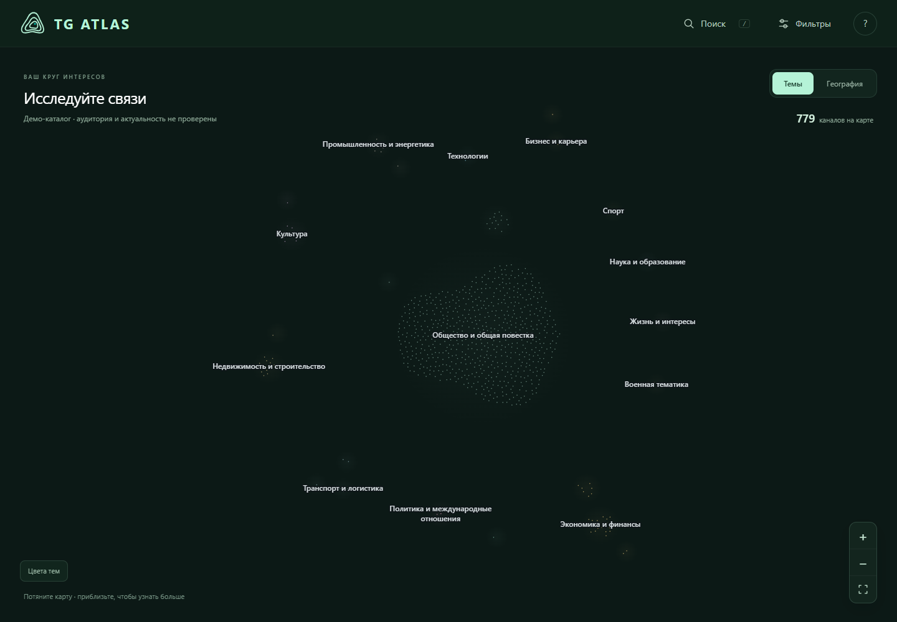

<p align="center">
  
</p>
<h1 align="center">TG ATLAS</h1>
<p align="center">Находите интересное. Исследуйте связи.</p>
<p align="center">
  Интерактивная карта публичных Telegram-каналов.<br />
  Темы, география и поиск — без перегруженного интерфейса.
</p>
<p align="center">
  <a href="https://github.com/zEeZja/tgatlas/actions/workflows/checks.yml"></a>
  
  
  
</p>
<p align="center">
  <a href="#быстрый-запуск">Запуск</a> ·
  <a href="docs/README.md">Документация</a> ·
  <a href="CHANGELOG.md">Что нового</a> ·
  <a href="CONTRIBUTING.md">Разработка</a>
</p>



## Что умеет

- **Карта на первом плане.** Поиск и фильтры открываются по кнопке; карточки не перекрывают весь интерфейс.
- **Два вида.** «Темы» — весь каталог без географических подписей. «География» — подходящие новостные, политические, военные и государственные каналы с указанной территорией.
- **Смысловая раскладка.** Опубликованный t-SNE сохраняет позиции при поиске и фильтрации. Без совместимого снимка доступна детерминированная тематическая схема.
- **Классификация 11v2.** Локальная CPU-модель использует профиль и доступные посты; допускает широкий раздел или отказ. Ручные исправления имеют приоритет.
- **Пополнение каталога.** Возобновляемый поиск, проверка публичных профилей, дедупликация и добавление без перезаписи существующих каналов; поддержка до 6000 записей.
- **Контроль публикации.** Предпросмотр, отдельное применение, архивы прежних файлов. PostgreSQL и сетевой сбор не нужны для просмотра готовой карты.

## Быстрый запуск

Нужен только Python 3.10+. Из корня проекта:

```bash
python -m http.server 4173 --directory web
```

Откройте **http://localhost:4173**. Устанавливать npm-зависимости для просмотра не нужно.

**В репозиторий включена актуальная карта: 3463 канала, классификация 11v2 и
сохранённые координаты t-SNE.** Публичный снимок от **23 ноября 2026 года**
воспроизводит локальную карту на дату фиксации; это не обновление в реальном времени.
Превью выше снято с этой карты, не с демо. [Состав и контрольные суммы](web/snapshot/manifest.json).

Локальные `web/data/` имеют приоритет. Без них карта загружает `web/snapshot/`.
Демокаталог из 779 записей используется только при отсутствии обоих каталогов.
Рабочая БД, тексты постов, диагностические отчёты и кеши в снимок не входят.

Для своей карты нужны локальные `web/data/channels.json` и, при наличии,
`atlas_layout.json`. Их готовят команды экспорта и публикации из инструкций ниже.
При открытии через `file://` используются соответствующие JS-файлы; обычный
HTTP-сервер предпочтительнее. [Формат и размещение данных](web/data/README.md).

## Как пользоваться

**Поиск** — название, тема или `@username`; клавиша `/` открывает панель.
**Фильтры** — тематика и дополнительные параметры; страна и регион доступны
в географическом виде. Нажмите точку, чтобы посмотреть канал.
Колесо и кнопки меняют масштаб, перетаскивание перемещает карту, `Esc` закрывает окно.

## Свой каталог

| Задача | Инструкция |
|---|---|
| Настроить PostgreSQL и создать каталог | [Установка и данные](docs/SETUP.md) |
| Найти новые каналы и объединить с картой | [Безопасный рост до 6000](docs/GROWTH_6000.md) |
| Собрать выборки постов напрямую или через RSSHub | [Посты и RSSHub](docs/RSSHUB_POSTS.md) |
| Классифицировать, проверить и опубликовать | [11v2](docs/classification/CLASSIFICATION_11V2.md) |
| Рассчитать и опубликовать t-SNE | [Раскладка](docs/classification/ATLAS_LAYOUT.md) |
| Разобраться в интерфейсе и географии | [Фронтенд](FRONTEND.md) |

Для ML нужны отдельные зависимости и предварительно загруженные локальные веса.
Карта, API и экспорт не запускают модель при открытии страницы. Сбор и публикация
выполняются только явно; существующий `.env` не заменяйте.

## Структура

```text
web/           статический интерфейс и Canvas-карта
src/           сбор, классификация, экспорт и проекция
scripts/       команды расчёта, проверки и публикации
config/        таксономия, правила и планы поиска
db/            схема и версионированные миграции PostgreSQL
tests/         Python, геометрия и браузерные сценарии
docs/          актуальные инструкции и отдельный архив исследований
requirements/  закреплённые базовые/API/dev-зависимости
```

## Ограничения

Темы, география и близость точек — ориентиры для исследования, **не проверка
достоверности канала и не вероятность правильности модели**. Независимая точность
11v2 на всём каталоге не установлена. Географический вид — группировка по охвату
контента, не местонахождение авторов или аудитории. Публикации и username устаревают.

Сборщик соблюдает лимиты и остановки доступа. Публичный RSSHub может быть недоступен
для скрипта даже при доступности в браузере; обход CAPTCHA не входит в проект.

**Секреты, дампы, посты, полные рабочие выгрузки и веса не публикуются.** Источники данных
и сторонние лицензии перечислены в [уведомлениях](docs/licenses/README.md).
Лицензия собственного кода пока не выбрана владельцем репозитория.
