# TG Atlas

Интерактивная карта публичных Telegram-каналов: тематические кластеры, географические острова, поиск, фильтры и карточки с описанием и аудиторией. Фронтенд работает без сборки; PostgreSQL хранит рабочий каталог, Python обновляет данные и готовит выгрузку.

[Как устроен проект: 8 схем](docs/architecture/README.md) · [Интерфейс и классификация](FRONTEND.md) · [Результаты аудита](docs/AUDIT.md) · [Предложения по развитию](docs/ROADMAP.md)



## Посмотреть карту за минуту

Из корня репозитория, с Python 3.10 или новее:

```bash
python -m http.server 4173 --directory web
```

Откройте **http://localhost:4173**. Для просмотра базы не нужны PostgreSQL, npm или Telegram API, если уже есть выгрузка. Если выгрузки нет, появится отмеченный плашкой демокаталог из 779 исходных каналов. Его аудитория неизвестна, актуальность не проверена.

Порядок загрузки статических данных: `web/data/channels.js` → `channels.json` → демо при отсутствии JSON (HTTP 404). Ошибка сервера или повреждённый JSON показываются как ошибка. При открытии `web/index.html` через `file://` используются JS-выгрузка или демо; локальный JSON браузер может блокировать. Для обычной работы используйте HTTP-сервер.

## Установка и настройка базы

Нужны Python **3.10+**, PostgreSQL и созданная база `tg_parser`. Node.js нужен только для проверок фронтенда.

Windows PowerShell — каждую строку запускайте отдельно:

```powershell
python -m venv .venv
.\.venv\Scripts\Activate.ps1
python -m pip install -r requirements.txt
Copy-Item .env.example .env
```

Linux/macOS:

```bash
python3 -m venv .venv
source .venv/bin/activate
python -m pip install -r requirements.txt
cp .env.example .env
```

Укажите в `.env` свои `PG_HOST`, `PG_PORT`, `PG_USER`, `PG_PASSWORD`, `PG_DATABASE`. Создать базу можно в pgAdmin или командой `createdb -U postgres tg_parser`. Файл `.env` читается из корня проекта и не попадает в Git.

```bash
python main.py init-db
```

Команда применяет идемпотентную схему из `db/schema.sql`. Перед обновлением существующей рабочей базы сделайте резервную копию, например `pg_dump -U postgres -Fc tg_parser -f atlas-backup.dump`.

## Актуальная карта без Telethon и без новостей

Первое заполнение базы из `config/channels.json` и обновление публичных профилей:

```bash
python main.py refresh-metadata --from-config --workers 2
python main.py export
python -m http.server 4173 --directory web
```

Обновляются название, описание и подписчики через `t.me/username`. Публикации не запрашиваются и не записываются. `TG_API_ID` и `TG_API_HASH` не нужны. `--from-config` добавляет только отсутствующие каналы: существующие свежие данные и неактивные записи сохраняются.

Для следующих обновлений:

```bash
python main.py refresh-metadata --workers 2
python main.py export
```

Для проверки одного уже добавленного канала:

```bash
python main.py refresh-metadata --channel breakingmash --workers 1
```

После экспорта обновите браузер с очисткой кеша. Обновление PostgreSQL само по себе не обновляет статическую выгрузку. В случае сетевой ошибки старые метаданные сохраняются. Частичная ошибка или пустая выборка дают код завершения `1`; успешная обработка — `0`. Проверяйте журнал перед экспортом: после частичного обновления данные могут иметь разную свежесть.

`--workers` ограничивает число параллельных загрузчиков (1–8). Общая частота запросов `SCRAPE_REQUEST_INTERVAL` и паузы Telegram действуют на весь пул; увеличение числа потоков не отменяет ограничения сервера.

## Тематики и география

Правила учитывают название, username, описание, исходную рубрику и ручные приоритеты. Каждая классификация содержит основания и признак необходимости проверки. Недостаток данных и неоднозначность сохраняются явно; название города само по себе не доказывает тематическую направленность канала.

| Файл | Назначение |
|---|---|
| `config/topics.json` | Темы, ключевые слова и псевдонимы |
| `config/topic_overrides.json` | Ручная тема по username |
| `config/geography_overrides.json` | Ручные география и охват |
| `src/region_aliases.py` | Словарь географических названий |
| `config/federal_channels.json` | Каналы федерального охвата |
| `config/channels.json` | Начальный каталог; рабочие записи хранятся в БД |

После изменения правил:

```bash
python scripts/sync_topics.py
python main.py export
python main.py audit-classification
```

Последняя команда работает офлайн по `web/data/channels.json` и создаёт `reports/classification-review.csv`. Она не исправляет БД автоматически. Исправление темы в интерфейсе хранится в LocalStorage конкретного браузера; для общего исправления внесите правило в конфигурацию. Точный порядок приоритетов и примеры разобраны в [схемах классификации](docs/architecture/README.md).

## Другие режимы

| Задача | Команда / документация |
|---|---|
| Статистика рабочей базы | `python main.py stats` |
| Инкрементальный сбор публикаций | `python main.py scrape --workers 2 --pages 5` |
| Сбор одного канала | `python main.py scrape --channel breakingmash --pages 1` |
| Проверка списка кандидатов | `python main.py import-candidates --help` |
| Проверка и импорт кандидатов | `python main.py discover-validate --help`, `candidate-import --help` |
| Все параметры | `python main.py --help`, `python main.py <команда> --help` |
| Telegram MTProto | `requirements-mtproto.txt`, `python main.py telegram-auth --help` |
| Экспериментальная ML-раскладка | `requirements-semantic.txt`, `python main.py build-semantic-map --help` |

`scrape` запрашивает публикации через `t.me/s/`, добавляет отсутствующие каналы конфигурации и обрабатывает активный каталог БД. Посты записываются пакетно с дедупликацией; курсор незавершённого обхода сохраняется в одной транзакции с постами. Сетевая загрузка параллельная, запись в БД последовательная. Параметр `--full-history` отключает инкрементальную остановку, но число страниц по-прежнему ограничено.

Новый кандидат должен пройти порог аудитории `MIN_CHANNEL_SUBSCRIBERS` (по умолчанию 1000); неизвестная аудитория не проходит импорт. Явный первоначальный каталог и уже существующие записи не удаляются этим правилом.

`build-geo-map` и `/api/geo-map` сохранены для совместимости. Текущая Canvas-карта строит расположение в браузере и не требует этих выгрузок. ML-раскладка также необязательна; команда требует явного подтверждения прав на используемое содержимое. Подробности прежних режимов сохранены в [историческом руководстве](docs/history/README-before-stability-audit.md); актуальные параметры всегда смотрите через `--help`.

## Необязательный HTTP API

```bash
python -m pip install -r requirements-api.txt
python -m uvicorn api:app --host 127.0.0.1 --port 8000
```

В `web/api.js` установите `CONFIG.mode: 'http'` и откройте **http://localhost:8000**. Пустой `httpBase` означает тот же сервер. `/api/channels` читает БД и классифицирует данные при запросе; экспорт не требуется. `/api/health` проверяет работоспособность процесса, **не доступность PostgreSQL**. OpenAPI доступен на `/docs`.

## Структура

```text
main.py, api.py      CLI и необязательный API
src/                сбор, PostgreSQL, классификация, экспорт
config/             исходный каталог и правила
web/                статический интерфейс и Canvas
web/data/           сгенерированные каталоги (не коммитятся)
db/schema.sql       таблицы, индексы и обновления схемы
scripts/            синхронизация правил браузера
tests/              Python, геометрия и браузерные сценарии
docs/architecture/  схемы Mermaid и готовые SVG
docs/history/       прежние инструкции и сохранённые отчёты
reports/            локальные CSV для ручной проверки
```

## Проверки для разработчика

```bash
python -m pip install -r requirements-dev.txt
python -m unittest discover -s tests
python -m ruff check .
npm ci
npx playwright install chromium
npm run test:layout
npm run test:frontend
```

Python-тесты не запрашивают Telegram и не требуют рабочей БД; интеграция API проверяется с подменённым подключением. При установленных только базовых зависимостях необязательный API-тест пропускается. Для Linux с системным Chromium можно указать `CHROMIUM_PATH=/usr/bin/chromium`. Браузерные тесты изолируют демо от вашей локальной выгрузки. Node.js **20+** рекомендуется для инструментов проверки.

Границы выполненного аудита, исправления и дальнейший согласуемый план — в [AUDIT.md](docs/AUDIT.md) и [ROADMAP.md](docs/ROADMAP.md).
