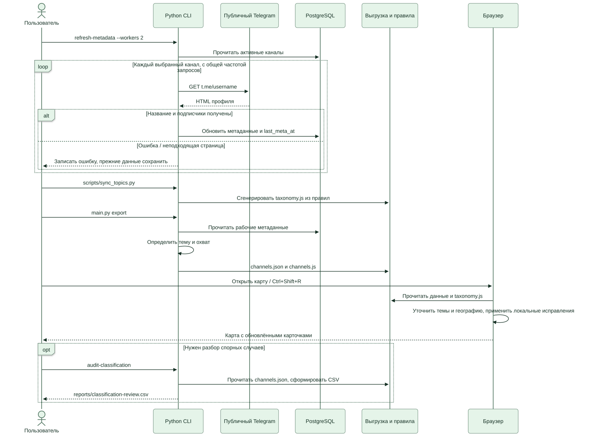

# Как работает TG Atlas

Этот путеводитель описывает **реализованный алгоритм**, сверенный с кодом основной ветки на 11 ноября 2026 года. Он помогает проследить путь от публичного профиля до точки на карте и понять причины решений. Это документация; она не запускает парсинг и не меняет данные.

Начните с общей схемы, затем выберите интересующий процесс. Все схемы доступны как SVG для просмотра и увеличения; рядом лежат редактируемые исходники Mermaid `.mmd`. [Общая схема в PNG](01-overview.png) удобна для скачивания.

На блок-схемах зелёным обозначены операции, синим — данные и сохранённое состояние, жёлтым — проверки, красным — ошибки или отсутствие достаточного вывода. Стрелка показывает передачу данных или следующий шаг; подпись на ней — условие перехода.

## Навигация

- [1. Общая работа проекта](#1-общая-работа-проекта)
- [2. Только подписчики и описание](#2-только-подписчики-и-описание)
- [3. Инкрементальный сбор публикаций](#3-инкрементальный-сбор-публикаций)
- [4. Классификация тем](#4-классификация-тем)
- [5. Географический охват](#5-географический-охват)
- [6. Построение карты](#6-построение-карты)
- [7. Где что хранится](#7-где-что-хранится)
- [8. Практический цикл обновления](#8-практический-цикл-обновления)

## 1. Общая работа проекта

**Как канал попадает на карту?**



[Открыть SVG отдельно](01-overview.svg) · [Исходник Mermaid](01-overview.mmd)

Рабочий каталог хранится в PostgreSQL. Обнаруженные кандидаты сначала проходят проверку и явный импорт. Конфигурационный каталог можно импортировать отдельно через `refresh-metadata --from-config`; команда `scrape` также синхронизирует его перед обходом.

Обновление метаданных и сбор постов — разные команды. Карта читает подготовленные метаданные и классификацию, а не таблицу публикаций. Посты пригодны для дальнейшей обработки, но автоматическая генерация сводок пока не реализована.

**Почему так:** карта может обновляться без Telegram API ID, авторизации и сбора новостей. Обнаружение кандидата не означает, что он автоматически включён в рабочий каталог.

Код: [CLI](../../main.py), [экспорт](../../src/exporter.py), [HTTP API](../../api.py).

## 2. Только подписчики и описание

**Что именно делает refresh-metadata?**



[Открыть SVG отдельно](02-metadata.svg) · [Исходник Mermaid](02-metadata.mmd)

Команда обращается к публичному профилю `t.me/username`, а не к ленте `t.me/s/username`. Загрузчики выполняют сетевую работу параллельно, но запись каждого результата в БД выполняет основной поток.

Успешный ответ обновляет название, описание, подписчиков и `last_meta_at`. Успешный профиль с пустым описанием очищает прежнее описание. Ошибка запроса или отсутствие обязательных признаков канала сохраняют прежние данные; пользовательский профиль без счётчика подписчиков не считается каналом.

**Почему так:** сбой сети не должен превращать подписчиков в ноль, а пустое настоящее описание нельзя путать с неудачной загрузкой. Таблицы `posts` и `scrape_checkpoints`, а также `last_parsed_at` эта команда не изменяет. Значение подписчиков может быть округлено самим публичным интерфейсом Telegram.

`--workers` ограничивает параллельность, а `SCRAPE_REQUEST_INTERVAL` задаёт общий интервал между запросами. Это разные ограничения: 4 загрузчика не означают 4 запроса в секунду. Запросы в полёте уже не остановить, но полученный `429` задерживает следующие запросы всех загрузчиков. Сетевые и `5xx` ошибки имеют ограниченные повторы; это опущено на схеме для читаемости.

Код: [public_metadata.py](../../src/public_metadata.py), [scraper.py](../../src/scraper.py), [parser.py](../../src/parser.py).

## 3. Инкрементальный сбор публикаций

**Почему повторный scrape быстрее и как он не пропускает разрывы?**


[Открыть SVG отдельно](03-polling.svg) · [Исходник Mermaid](03-polling.mmd)

Для канала известен максимальный сохранённый ID публикации — текущий порог (`last_seen`). Повторный опрос начинает с самой свежей страницы и отбирает новые ID. Если на ней уже достигнут старый порог и нет недочитанного участка, достаточно одного запроса.

`--pages` ограничивает работу за один запуск. Если новые публикации не уместились в лимит, сохраняются `before_id` — откуда продолжать — и `target_id` — до какого старого порога дочитывать. Следующий запуск сначала проверяет свежие посты, затем продолжает разрыв. Для продвижения по разрыву оставляйте бюджет больше одной страницы.

**Пример:** раньше был сохранён ID 100. Удалось получить только 202 и 201. Порог для свежих постов теперь 202, но отдельный курсор продолжит чтение от 201 до прежнего 100. Без него посты между 100 и 201 могли бы потеряться при следующем опросе.

Посты записываются пакетами с уникальностью `(channel_id, tg_message_id)`. Курсор и посты сохраняются в одной транзакции: ошибка записи откатывает оба изменения. Рабочая очередь ограничена числом загрузчиков, а не числом всех каналов.

**Границы:** первая загрузка нового канала берёт только заданный лимит страниц и не обещает полную историю. `--full-history` отключает остановку по старому ID, но тоже ограничен `--pages`; имеющийся инкрементальный курсор при этом не изменяется. Пустая страница с распознанными метаданными завершает чтение участка; повреждённый ответ считается ошибкой и не очищает курсор; игнорируемый `before` останавливает повторение и сохраняет курсор при повторном опросе. Неизвестная ошибка канала не продвигает его курсор.

Код: [pipeline.py](../../src/pipeline.py), [пакетная запись и курсоры](../../src/db.py), [тесты опроса](../../tests/test_polling.py).

## 4. Классификация тем

**Почему канал получает конкретную категорию?**



[Открыть SVG отдельно](04-topics.svg) · [Исходник Mermaid](04-topics.mmd)

Приоритет — сверху вниз. Локальная корректировка существует только в браузере; Python-экспорт и API о ней не знают. Правило владельца задаётся в `config/topic_overrides.json`. Исходная специализированная рубрика сохраняется, а общие `general`/`other` можно уточнять автоматически.

| Сигнал | Вес одного совпадения |
|---|---:|
| Название | 4 |
| Username | 3 |
| Описание | 2 |

На каждое поле учитывается не более трёх совпадений одной темы. Баллы «Новостей» умножаются на 0,5: само слово «новости» не должно вытеснять «Науку» или «Недвижимость». Порог обычной темы — 3, общей новостной — 2. Это веса правил, **не проценты уверенности**. Варианты ниже порога не вытесняют подходящую тему.

При отсутствии подходящей темы проверяется городской контекст. Например, «Мурманск сейчас» и предложение прислать новость дают общие новости. Но медицинское описание с достаточными признаками получит «Здоровье» раньше этого правила. Одно название города без уточнений допускает новостную рубрику с отметкой проверки.

**Почему бывают ошибки:** короткое имя-бренд без содержательного описания не раскрывает тематику; несколько подходящих тем дают неоднозначность; исходная ручная рубрика может быть неверна. Неизвестные случаи остаются для проверки, а не маскируются случайной категорией. Публикации в этой классификации не анализируются.

Код: [Python](../../src/topic_keywords.py), [браузер](../../web/topics.js), [словарь](../../config/topics.json), [общие примеры](../../tests/fixtures/topics.json).

## 5. Географический охват

**Почему место может остаться неуточнённым?**



[Открыть SVG отдельно](05-geography.svg) · [Исходник Mermaid](05-geography.mmd)

География определяется независимо от темы: «Политика» может относиться к Москве, нескольким регионам или всей стране. Поле страны само по себе не доказывает охват всей страны.

Принятые регионы берутся из `regions`/`region`. Устаревшая отметка проверки позволяет отбросить неподтверждённое значение и попытаться восстановить однозначное место из названия. Для автоматического восстановления не должно быть ручного охвата, федеральной защиты или уже принятого региона. Ручные правила находятся в `config/geography_overrides.json`.

Российские алиасы включают города и формы слов: «Химки», «Химках», «Перми». Более длинное вложенное название приоритетнее короткого: «Нижний Новгород» не становится Новгородской областью. Короткие названия не превращены в произвольные префиксы: «Читаем книги» не означает Читу.

Зарубежные места берутся из расширяемого `config/foreign_geography.json`; сейчас справочник небольшой. «Карьера в Португалии» может получить страну PT, «Развлечения в Ташкенте» — регион Ташкент и страну UZ. Конфликт нескольких мест не разрешается случайным выбором.

**Почему неизвестное не равно международному:** отсутствие данных ничего не говорит о широте аудитории. Международный охват задаётся явно. Внутренний тип `region` нужен модели, но лишней кнопки «Один регион» в интерфейсе нет: конкретный регион выбирается напрямую.

Код: [geography.py](../../src/geography.py), [title_region.py](../../src/title_region.py), [алиасы](../../src/region_aliases.py), [правила владельца](../../config/geography_overrides.json).

## 6. Построение карты

**Откуда берутся острова и что означают расстояния?**



[Открыть SVG отдельно](06-map.svg) · [Исходник Mermaid](06-map.mmd)

Сначала формируются группы, затем рассчитываются координаты. В тематическом режиме главный уровень — тема, внутри неё географические соседства. В региональном режиме — наоборот.

Посев случайности зависит от идентификаторов: при том же наборе данных и правилах повторная загрузка и перестановка строк не перемешивают карту. Пространственная сетка помогает отклонять слишком близкие позиции. Между островами остаётся свободное место; рельеф — подсветка и сглаженные контуры, которые можно отключить.

В региональном режиме используются географические центры и проекция Ламберта. Соседние острова смещаются для устранения пересечений; размер влияет на смещение. Поэтому результат — приблизительная картограмма с ориентиром России, а не точная карта границ. Группы без подходящих координат расположены отдельно снизу.

**Что пересчитывается:** фильтр меняет набор видимых ID; зум и перетаскивание меняют камеру. Смена режима, темы канала или исходного каталога может пересчитать раскладку. Добавление новых каналов может изменить общую компоновку.

**Важное ограничение:** близость на этой карте выражает тематико-географическую группировку. Здесь нет эмбеддингов публикаций, t-SNE или доказанной метрики смысловой близости. Старый экспериментальный `build-semantic-map` существует отдельно и не используется текущим интерфейсом по умолчанию.

Код: [layout.js](../../web/layout.js), [Canvas и пространственный индекс](../../web/map.js), [управление интерфейсом](../../web/app.js).

## 7. Где что хранится

**Какие данные являются исходными, производными и локальными?**



[Открыть SVG отдельно](07-storage.svg) · [Исходник Mermaid](07-storage.mmd)

ER-диаграмма упрощена: она показывает основные связи и поля, а не все индексы и миграции. `channels` — рабочий каталог; `channel_candidates` — отдельная очередь кандидатов. Источников у одной записи может быть несколько.

| Данные | Где находятся | Что их меняет |
|---|---|---|
| Название, описание, подписчики | PostgreSQL, `channels` | `refresh-metadata`, `scrape`, опциональный `mtproto-enrich` |
| Сохранённая география | PostgreSQL, `channels` | Отдельный `backfill-region`; правила чтения могут уточнять отображение без записи |
| Публикации | PostgreSQL, `posts` | `scrape` / опциональный `mtproto-scrape` |
| Недочитанный участок | PostgreSQL, `scrape_checkpoints` | Инкрементальный `scrape`, вместе с записью постов |
| Темы и охват для карты | Вычисленные поля экспорта/API и браузера | Текущие правила классификации |
| Статическая выгрузка | `web/data/channels.json` и `.js` | `export` |
| Словари и правила браузера | `web/taxonomy.js` | `scripts/sync_topics.py` |
| Ручная тема посетителя | LocalStorage его браузера | Карточка → исправление темы |
| Демокаталог | `web/demo.js` | Поставляемый пример; не живая БД |

**Почему export не переписывает БД:** он строит представление для карты. Для диагностики исходные рубрики сохраняются отдельно от вычисленных `primary_category`, `geography_scope` и других полей. `last_meta_at` означает успешное обновление метаданных, `last_parsed_at` — успешный опрос публикаций; это разные события. Дата генерации выгрузки тоже не равна дате обновления каждого канала.

`posts` имеет составную уникальность `(channel_id, tg_message_id)`. `telegram_id` уникален, когда известен. У кандидата связь с импортированным каналом может отсутствовать. Источник кандидата имеет составной ключ `(username, source_name, source_ref)`.

`schema_migrations` хранит применённые версии, имена SQL-файлов и их SHA-256. `init-db` применяет ожидающие изменения одной транзакцией, с блокировкой параллельного запуска. Чтение курсоров больше не создаёт таблицы. `/api/ready` проверяет подключение, историю и рабочие колонки; `/api/health` проверяет только процесс. Подробности обновления и восстановления — в [инструкции по PostgreSQL](../DATABASE.md).

Код: [миграции](../../db/migrations/), [migrations.py](../../src/migrations.py), [schema.sql](../../db/schema.sql), [db.py](../../src/db.py), [exporter.py](../../src/exporter.py).

## 8. Практический цикл обновления

**Какие действия нужны, чтобы увидеть свежую карту?**



[Открыть SVG отдельно](08-refresh.svg) · [Исходник Mermaid](08-refresh.mmd)

Схема показывает обычный статический режим без Telethon. Команды запускаются из корня проекта, по отдельности:

```bash
python main.py refresh-metadata --workers 2
```

```bash
python scripts/sync_topics.py
```

```bash
python main.py export
```

```bash
python -m http.server 4173 --directory web
```

После этого открыть `http://localhost:4173` и обновить страницу без кеша. Для пустой базы сначала нужны настройка PostgreSQL, `init-db` и явный импорт `refresh-metadata --from-config`. Подробности — в [инструкции запуска](../../FRONTEND.md).

**Если изменились только правила:** получать метаданные заново не требуется; достаточно синхронизации правил, экспорта и обновления страницы. Для исследования результатов: `python main.py audit-classification` → `reports/classification-review.csv`. Этот аудит работает офлайн по JSON, не меняет исходную выгрузку и не учитывает LocalStorage посетителя.

**HTTP-режим:** вместо статической выгрузки браузер обращается к `/api/channels`, который читает БД и применяет тот же Python-классификатор. Для отображения в этом режиме export не обязателен; изменения конфигурации требуют синхронизации правил браузера и перезапуска API. Локальная корректировка всё равно применяется в браузере.

**Демо:** сначала проверяется JS-каталог, затем JSON. Только при отсутствии JSON (HTTP 404) загружается `demo.js`; через `file://` после отсутствующего JS используется демо. Ошибки сервера и формата данных показываются явно. Жёлтая плашка означает пример данных, а не результат текущего обновления вашей БД.

Код: [main.py](../../main.py), [api.js](../../web/api.js), [api.py](../../api.py), [audit](../../src/classification_audit.py).

## Если результат непонятен

| Наблюдение | Что проверить первым |
|---|---|
| Подписчики обновились, а карта старая | Выполнен ли export; из какой папки запущен сервер; кеш страницы |
| Описание стало актуальным, но тема прежняя | Локальная тема, правило владельца или сохранённая специализированная рубрика имеют приоритет |
| Явный город остаётся неизвестным | Есть ли алиас, нет ли конфликта мест или ручного охвата; проверить CSV-аудит |
| Большинство каналов всё ещё «Новости» | Достаточно ли специализированных признаков в метаданных; не является ли это общей исходной рубрикой |
| Несколько загрузчиков, но опрос не мгновенный | Общая частота запросов и паузы Telegram ограничивают весь пул |
| После выбора категории пропал регион | Список регионов ограничен текущей категорией; при её смене географический фильтр сбрасывается |
| Кнопки «Один регион» нет | Это внутренний тип охвата, а в интерфейсе достаточно выбрать конкретный регион |

## Как поддерживать схемы

При изменении поведения обновляйте соответствующий `.mmd`, пояснения и экспортированный SVG. Mermaid-исходники не содержат токенов, данных подключения или приватной выгрузки. Для чтения SVG дополнительные зависимости проекта не нужны. При редактировании используйте Mermaid-совместимый редактор/рендерер; SVG в этой версии проверены рендерингом Mermaid в Chromium.


## Уточнения после аудита стабильности

- Повторный импорт конфигурации добавляет только отсутствующие username; свежие и неактивные записи не перезаписываются.
- `scrape` и `refresh-metadata` возвращают ненулевой код при частичной ошибке или пустой выборке. Неизвестный явно выбранный канал вызывает ошибку.
- Ошибка SQL в обновлении метаданных откатывает весь канал вместе с постами и курсором.
- Правила тем, географии и федерального охвата читаются один раз на пакет экспорта, аудита или запроса API. Это снимок прочитанных файлов, а не транзакция между файлами: менять конфигурацию следует между запусками.
- Файлы `channels.json`, `channels.js` и `taxonomy.js` заменяются атомарно каждый по отдельности. Пара JSON/JS не является общей файловой транзакцией; браузер предпочитает JS, поэтому после сбоя второй записи экспорт нужно повторить.

Подробные результаты и границы проверки: [аудит](../AUDIT.md). Предложения, требующие согласования: [план](../ROADMAP.md).
