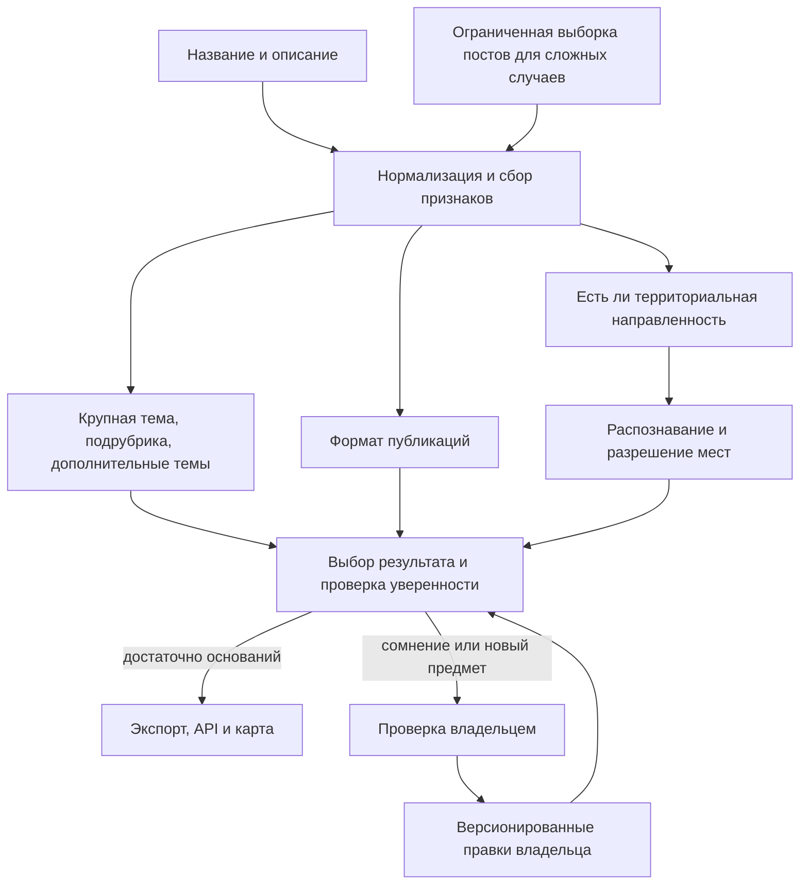

# Предложение: классификация тем и территориальной направленности

Статус: **для обсуждения, поведение проекта не изменяет**. Дата: 12 ноября 2026 года.

Основание: предложения владельца после проверки 60 каналов и анализ текущего кода. Новый приложенный RAR превышает лимит передачи 32 МиБ и в среду не загружен. В репозитории по-прежнему находится исходная выборка с 0 подтверждённых строк. Поэтому индивидуальные исправления этих 60 каналов здесь не анализировались; для этого нужен отдельно экспортированный `classification-reviewed.csv`. Приведённые ниже тематические группы — кандидаты, а не вывод из ещё не прочитанной разметки.

## 1. Что показывает текущая реализация

Сейчас `config/topics.json` содержит 22 плоские тематики, включая «Не определено», и 5 широких разделов. Разделы не образуют полноценную рабочую иерархию рубрик. На одном уровне находятся «Бизнес и экономика» и узкие «Криптовалюты», «ИИ и нейросети». Формат «Новости» и географический признак «Международное» соседствуют с предметными темами.

Классификатор выбирает только существующий ID. Функция `read_review` также валидирует ожидаемую тему по этому закрытому списку. Поэтому отсутствие подходящего класса нельзя исправить одним обучением. Текущая локальная модель предсказывает только основную тему; дополнительные теги и география определяются отдельно. В `topic_model.train` классы с менее чем 3 train-примерами исключаются. Технический минимум 40 train / 10 test не означает достаточный объём для высокой точности на десятках тематик.

География содержит `region`, `multi_region`, `country`, `global`, `unknown`. Отдельного состояния для предметного канала без территориальной направленности нет. Система поэтому смешивает отсутствие географического смысла с настоящей ошибкой распознавания места.

Код: [тематики](../../config/topics.json), [правила](../../src/topic_keywords.py), [география](../../src/geography.py), [верификация](../../src/classification_review.py), [модель](../../src/topic_model.py).

## 2. Разделить независимые характеристики канала

Предлагаются четыре результата:

1. **Основная тема:** предмет, вокруг которого строится канал.
2. **Дополнительные темы:** несколько устойчивых сопутствующих предметов.
3. **Формат:** новости, аналитика, образовательные материалы, авторский блог, афиша, сообщество, предложения/каталог. Возможно несколько форматов; они не заменяют предмет.
4. **Территориальная направленность:** относится ли содержание к месту и к какому.

Примеры:

| Канал по содержанию | Тема | Формат | Территориальная направленность |
|---|---|---|---|
| Налоги и бухгалтерия РФ | Финансы → налоги | Разборы, консультации | Страновая: Россия |
| Управление продуктом и командами | Бизнес → управление | Обучение, авторский блог | Без территориальной привязки, если это следует из содержания |
| Предпринимательское сообщество Казани | Бизнес → предпринимательство | Сообщество | Местная: Казань / Татарстан |
| Рецепты домашней кухни | Еда → кулинария | Обучение | Без территориальной привязки |
| Городская сводка Химок | Общество → городская жизнь | Новости | Местная: Химки / Московская область |
| Международная политическая аналитика | Политика → международные отношения | Аналитика | Международная повестка |

«Новости о финансах» остаются финансами, а новостной характер сохраняется как формат. Для общей новостной ленты допустима широкая «Общая повестка», если узкую устойчивую тему выделить нельзя.

## 3. Расширять таксономию через иерархию

На карте стоит сохранить управляемое число крупных тематических областей, а точность увеличить подрубриками и тегами. Ориентир для обсуждения — 12–18 крупных групп и 40–60 подрубрик, **не обязательная квота**. Финальный состав определяется существующим каталогом и подтверждёнными замечаниями владельца.

Кандидаты для детализации и дополнения:

| Направление | Подрубрики для обсуждения |
|---|---|
| Экономика и финансы | Макроэкономика, банки, инвестиции, личные финансы, криптовалюты, налоги |
| Бизнес и карьера | Предпринимательство, управление, маркетинг, продажи, HR, вакансии |
| Технологии | Разработка, ИИ, информационная безопасность, гаджеты, телеком |
| Наука и образование | Научные области, космос, языки, школьное/высшее/профессиональное образование |
| Здоровье | Медицина, психология, питание, фитнес; разделять профессиональный и бытовой контекст |
| Жизнь и интересы | Семья и дети, отношения, красота и уход, еда и рецепты, дом и сад, животные |
| Культура и досуг | Кино, музыка, литература, искусство, события, юмор, игры |
| Недвижимость и строительство | Рынок жилья, строительство, ремонт, ЖКХ |
| Транспорт и промышленность | Авто, железная дорога, авиация, морской транспорт, логистика; отрасли промышленности отдельно |
| Общество, политика и право | Городская жизнь, социальные вопросы, политика, международные отношения, юридические разборы; военная тематика сохраняется отдельно |

Строки таблицы показывают соседние области и кандидатов: они не предписывают объединить, например, транспорт и промышленность одним кластером. Существующие спорт, путешествия и другие подходящие темы сохраняются и уточняются по необходимости.

У каждого узла нужны стабильный ID, родитель, определение, включаемые/исключаемые случаи и примеры. При пересечении предметов выбирается одна основная тема и дополнительные теги. Новая редкая тема может сначала существовать как подрубрика без отдельной обученной модели.

Важно разделить причины отказа:

- недостаточно сведений;
- неоднозначность между существующими темами;
- возможная тема вне текущего справочника;
- подтверждённая владельцем нехватка конкретной рубрики;
- действительно смешанная повестка без устойчивой основной темы.

Алгоритм может предложить «возможный пробел справочника», но не считать такую догадку доказанным новым классом. В форме нужны поле «Какой темы не хватает?» и причина исправления. Это позволит собирать новые рубрики из реальных повторяющихся случаев.

Изменения геометрии кластеров в эту работу не включаются. Карта по-прежнему использует основную тему; иерархия и теги расширяют классификацию и фильтры, не создавая несколько точек одного канала.

## 4. Заменить неоднозначный «охват» понятной направленностью

По названию, описанию и публикациям мы не измеряем фактическое местонахождение подписчиков или охват аудитории. В интерфейсе лучше говорить **«Территориальная направленность»**.

Предлагаемые состояния:

| Состояние | Значение |
|---|---|
| Местная | Канал систематически посвящён конкретному городу/региону |
| Несколько территорий | Есть устойчивый набор мест, например соседние регионы |
| Страновая | Предмет связан со страной: законодательством, рынком, национальной повесткой |
| Международная | Устойчивая повестка нескольких стран / международных отношений |
| Без территориальной привязки | Достаточно сведений о канале, но его предмет не зависит от конкретного места |
| Недостаточно данных | Направленность определить нельзя |

Внутренне можно сначала определять применимость географии, а затем её детализацию. Для нетерриториального канала поле региона не обязательно и не должно ухудшать показатель качества. Для сомнительного канала нужен отдельный отказ.

Не переносить все `unknown` в «Россия» или «Без привязки». Русский язык, страна из старой конфигурации и сама тема «Бизнес» недостаточны для такого решения. Канал о налогах РФ и канал об общих навыках управления различаются по территориальному смыслу; локальный бизнес-клуб также сохраняет регион.

В обычной карточке географический блок для нетерриториального канала можно сворачивать. Региональные фильтры сохраняются: например, при выборе Казани показывается местный бизнес; добавление нетерриториальных каналов в такую выборку должно быть отдельной пользовательской опцией, а не скрытым смешиванием.

## 5. Усилить региональный классификатор структурно

Сейчас основа — плоский словарь алиасов, совпадения в названии/описании и подсказка каталога. Расширять его стоит через справочник **страна → субъект → населённый пункт → при необходимости район** с устойчивыми ID и версией данных.

Предлагаемый порядок:

1. Найти упоминания мест: полное название, словоформа, сокращение, транслитерация, локальный алиас.
2. Привести к каноническим объектам и их родительским территориям.
3. Разрешить неоднозначность по контексту, а не выбирать первый одноимённый город.
4. Отдельно решить, описывает ли найденное место направленность канала.
5. Сохранить источник, кандидатов, причину выбора/отказа.

В качестве основы нужен поддерживаемый офлайн-справочник населённых пунктов; для пилота достаточно проверенного поднабора нужных стран/городов с указанием источника. Обновление справочника версионируется. Морфология и точные алиасы предпочтительнее ослабления всех префиксных правил. Нечёткое совпадение полезно как предложение для проверки.

Обязательные отрицательные примеры:

- Советск и Благовещенск могут обозначать разные населённые пункты;
- Киров и Кировск нельзя автоматически считать одним местом;
- Ленинградский проспект в Москве не означает Ленинградскую область;
- место рождения автора и рекламный контакт не определяют местную направленность;
- федеральное медиа не становится московским из-за нескольких новостей о Москве.

Отдельные упоминания в постах хранятся как упоминания. Они не становятся автоматически местом самого канала.

## 6. Посты — отдельный проверяемый источник

Публикации могут помочь распознать канал с коротким/брендовым названием или пустым описанием. Они также могут усилить ошибку: реклама, серия репостов и один резонансный сюжет искажают несколько последних сообщений.

Предлагается пилот на 20–30 каналах: часть с понятными метаданными, часть с неоднозначными. Для сравнения этих каналов владелец должен видеть одинаковую полную основу разметки, включая выбранные публикации: прежнее «недостаточно данных» по одному описанию не всегда означает неизвестную настоящую тему.

Параметры пилота:

- сначала использовать уже имеющиеся посты, если они есть;
- при необходимости получать ограниченное число публичных страниц через существующий HTTP-клиент, без обязательного Telethon;
- ориентир — не более 2–3 страниц, затем 10–20 содержательных сообщений из доступного окна;
- добиваться разнообразия дат/сюжетов, насколько позволяет окно; не обещать месячную историю за несколько запросов у частого канала;
- отмечать недостаточное временное разнообразие и малый объём, а не повышать уверенность;
- рекламные и сервисные сообщения фильтровать, копии учитывать один раз; репосты различать по источникам/повторам, а не безусловно удалять все;
- агрегировать несколько независимых признаков, сохраняя основания решения;
- кешировать выборку с временем и ID сообщений; повторно получать данные по необходимости;
- сохранять общий ограничитель частоты запросов и явные бюджеты на канал/запуск.

**Важная особенность текущего проекта:** основной сборщик вычисляет watermark по максимальному ID из таблицы `posts`, а состояние обхода хранит в `scrape_checkpoints`. Если просто записать туда несколько последних сообщений для классификации, можно изменить условия остановки последующего новостного сбора и пропустить промежуток истории.

Поэтому классификационная выборка должна иметь отдельный кеш/хранилище и не продвигать новостной watermark, `scrape_checkpoints` или `last_parsed_at`. Сетевой клиент и парсер переиспользуются, запись и состояние обхода разделяются. Ошибка получения постов не мешает обновлению описаний и работе карты.

Код: [опрос](../../src/pipeline.py), [watermark и запись постов](../../src/db.py), [HTTP-клиент](../../src/scraper.py), [парсер](../../src/parser.py).

## 7. Обучение после определения пространства меток

60 проверок полезны для диагностики границ тем и первого набора примеров. При большом числе новых подрубрик это не обеспечивает достаточно примеров каждого класса. Их распределение и содержание пока не прочитаны, поэтому оценка пригодности для обучения преждевременна.

Предлагается:

1. Зафиксировать таксономию и определения географических состояний.
2. Сохранить оригинальную разметку владельца; перенести однозначно совместимые метки, уточнить только затронутые разделением классов.
3. Сначала сравнить имеющийся TF-IDF/линейный классификатор с обновлёнными правилами.
4. Для смысловых формулировок и небольшого объёма разметки рассмотреть готовый многоязычный/RU-энкодер как отдельный кандидат; сравнить качество и затраты на том же наборе. Это не обязательная немедленная замена.
5. Крупную группу определять раньше подрубрики; узкую рубрику назначать при достаточных данных, иначе сохранять корректную широкую группу.
6. Основную и дополнительные темы оценивать отдельно. Применимость географии и распознавание конкретного места также не сводить к одному тематическому классификатору.
7. Порог уверенности выбирать по проверочным данным и классу, не считать балл модели гарантией правильности.

Обучение с нуля большой нейросети на 60 примерах не является разумным первым шагом. Полностью автоматическое включение текущей модели до уточнения классов и проверки ошибок также не предлагается.

Посты сначала нужны как источник дополнительных признаков. Использование их при обучении рассматривается после проверки пилота и состава входных данных; внешняя передача данных не является частью этого плана по умолчанию.

## 8. Сохранить ручную работу и измерять качество честно

Оригинальный файл 60 проверок сохраняется без перезаписи. Нужны версии формы, таксономии и меток. Широкая подтверждённая тема остаётся полезной даже при отсутствии подтверждённой подрубрики.

Старое `country` проверяется на смысл: реальная страновая повестка или попытка обозначить отсутствие локальной привязки. Старое `unknown` тоже не заменяется массово. Для спорных переходов формируется короткая очередь уточнения.

Если эти 60 примеров используются для настройки правил или схемы, они становятся разработческой выборкой. Итоговую точность надо проверять на других подтверждённых каналах, которые не использовались для подбора изменений. Варианты username, переименования известного Telegram ID и дубликаты текстов учитываются при разделении групп.

Сравнение на одинаковых каналах:

- текущие правила по профилю;
- обновлённые правила/модель по профилю;
- та же система с ограниченной выборкой постов.

Показатели:

- качество крупной группы и подрубрики по отдельности;
- precision/recall/macro-F1 по классам, качество дополнительных тегов;
- доля каналов с назначением и доля ошибочных уверенных назначений;
- качество определения территориальной направленности отдельно от точности города/региона;
- ложные местные назначения предметным/общенациональным каналам;
- стоимость запросов, время обновления, доля недостаточных выборок постов.

«Без территориальной привязки» и «Недостаточно данных» считаются отдельно. Снижение числа неизвестных через переименование состояния не выдаётся за рост точности. Пилот с постами принимается, только если он улучшает полезные назначения при контролируемых ложных ответах; конкретный порог согласуется по исходным метрикам.

Подтверждённая правка владельца имеет приоритет. Если профиль существенно изменился, метка сохраняется с отметкой о необходимости повторной проверки; источник и дата подтверждения нужны для учёта смены направленности канала.

## 9. Общий поток

## 10. Порядок внедрения после согласования

1. Получить отдельный CSV 60 проверок. Прочитать его как исходные данные, включая заметки и новые названия; сначала не пропускать новые предложения через старый валидатор закрытых классов.
2. Разобрать ошибки по причинам и подготовить конкретную версионированную таксономию с границами тем. Согласовать её и состояния географии.
3. Обновить схему результатов, форму проверки и совместимость старых CSV/исправлений. При изменении БД использовать существующие версионированные миграции; старые метки не затирать.
4. Реализовать новые темы и географическую модель на метаданных, расширить справочник мест и отрицательные тесты. Согласовать Python/JavaScript, экспорт и API. Дать пользователю результат без обязательного парсинга постов.
5. Обучить/сравнить модели на достаточных подтверждённых данных. Оставить редкие подрубрики без автоматического назначения, если поддержки мало.
6. Провести ограниченный эксперимент с постами и сравнением режимов. Решить, оправдано ли их включение и для каких каналов.

Текущий стек Python + PostgreSQL + статический фронтенд сохраняется. Это доработка конвейера классификации; перестройка всей карты, генерация сводок и массовый регулярный сбор новостей в данное предложение не входят.
