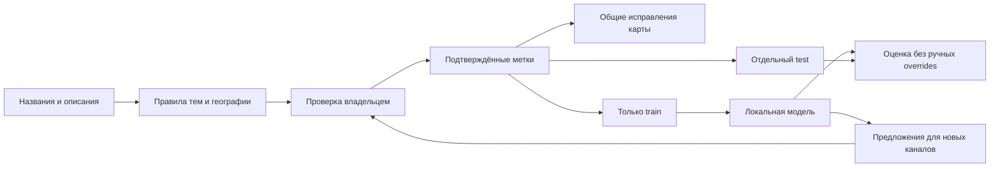

# Темы, регионы и обучение классификатора

Актуальная доработка: **[V3 — отраслевые направления, необязательная география и раздельная проверка](V3.md)**. Старые инструкции ниже сохранены для совместимости; для новых команд и формы используйте V3.

Каркас **[классификации V2](V2.md)** дополнен V3: приоритетные отрасли, необязательная география и независимые подтверждения. Настоящая модель на ответах владельца пока не обучена. Перед обучением проверьте полный сохранённый CSV через `inspect`; сведения о полноте выгрузки и ошибках нельзя заменять счётчиком прогресса браузера.

## С чего начать владельцу

После обновления репозитория откройте на компьютере:

**[../review/classification-sample.html](../review/classification-sample.html)**

Перед обновлением формы скачайте CSV из прежней версии. Обновлённая форма переносит старый прогресс на том же адресе и умеет импортировать CSV. Состав исходных 200 каналов сохранён. Подробности — в [инструкции перехода](V2.md#обновление-существующей-установки).

Это автономная форма на 200 каналов. В ней нет внешних библиотек, запросов к Telegram или отправки данных на сервер. Для каждого канала:

1. Прочитайте название и содержательную часть описания. Служебные контакты и регистрационные строки скрыты.
2. Исправьте основную тему и при необходимости отметьте дополнительные темы.
3. Проверьте охват. Город/регион и тема независимы: финансовый канал не становится московским из-за города проживания автора.
4. Для одного региона укажите один канонический регион; для нескольких разделяйте названия символом `|`. Используйте двухбуквенный код страны, например RU, UZ, RS, ID.
5. Если данных недостаточно, оставьте неопределённую тему/географию и поясните причину. Не назначайте «вся страна» или «весь мир» только ради заполнения.
6. Отметьте **«Проверено мной»**. После проверки скачайте CSV. Строки без этой отметки не применяются и не используются при обучении.

Прогресс хранится локально в браузере; скачанный CSV нужен для передачи и резервного сохранения. Можно проверить часть выборки, скачать промежуточный результат и продолжить в том же браузере. Не очищайте его LocalStorage до скачивания файла. Для самостоятельного продолжения CSV можно редактировать в Excel/LibreOffice: разделитель `;`, кодировка UTF-8, подтверждение — `reviewed=yes`.

Если браузер блокирует открытие HTML с диска, из корня проекта выполните:

```bash
python -m http.server 4174 --directory docs/review
```

Откройте http://localhost:4174/classification-sample.html. На GitHub HTML обычно показывается как исходник: форму нужно открыть из скачанного репозитория.

## Какие данные входят в готовую выборку

Использован доступный локальный JSON-снимок от **5 ноября 2026 года**: 1042 строки, 971 уникальный username без учёта регистра. Встречаются 71 вариант-дубликат по регистру; при подготовке выборки они объединены, рабочая БД не очищается.

В выборке 200 каналов: сложные/неопределённые случаи, разные темы и детерминированная случайная часть. Это **стратифицированная**, а не равномерная выборка каталога. Описания берутся только из профилей, публикации не читаются. Некоторые предметы в каталоге представлены недостаточно; для уверенного обучения всех классов понадобятся дополнительные примеры.

Столбцы `suggested_*` — предложения. `expected_*` изначально заполнены предложениями для удобства, но не являются подтверждёнными ответами, пока `reviewed` не станет `yes`. Разделение `train/test` выполнено заранее; одинаковые тексты и варианты регистра не должны попадать по разные стороны. Форма скрывает технические поля, CSV сохраняет их.

Если ваша БД уже свежее, сначала экспортируйте актуальные метаданные и создайте новую выборку. Не заменяйте текущую выборку посреди её проверки: меняются входные тексты и состав каналов.

```bash
python main.py export
python scripts/classification_quality.py prepare --input web/data/channels.json --output reports/classification-review.csv --size 200
```

Команда создаёт CSV и соседний HTML. JSON-выгрузку и PostgreSQL она не меняет.



## Уже исправлено

- Официальные названия регионов участвуют в поиске напрямую. Добавлены пропущенные точные формы Пензы, Башкирии, Тюмени, названий крупных городов и отдельных локальных названий. Короткие корни не стали произвольно совпадать со всеми похожими словами.
- Если название не даёт региона, проверяется содержательная часть описания с локальным контекстом, затем подсказка каталога. Конфликты остаются на проверку. Рекламные контакты и биографические упоминания не назначают регион каналу.
- Россия распознаётся как явно названная страна; Бали и Белград добавлены как географические объекты. Федеральная запись со старым локальным регионом больше не локализуется этим устаревшим полем. Ручные указания охвата имеют приоритет.
- Профессиональные определения в описании уточняют некоторые темы: промышленность, транспорт, кибербезопасность и другие. Добавлены положительные и отрицательные примеры.
- «Авторский» не считается автомобилями, «искусственный интеллект» не добавляет культуру, `transport`/`passport` не дают спорт из-за подстроки.
- Общая запасная рубрика «Новости» теперь требует проверки, а не выглядит уверенной тематической классификацией. Дополнительные темы отображаются в карточке.

Python и браузер используют согласованные правила. Обучение не заменяет словарь географии: привязка города к субъекту и проверка конфликтов лучше остаются явными. Персональный регион автора, территория бизнеса и география публикаций могут различаться.

[Сравнение на исходном снимке](catalog-summary.json) содержит счётчики и изменившиеся назначения, SHA-256 источника и базовый коммит `91fafc9`. Уменьшение неизвестных **не является доказательством точности**. Эти примеры использовались для исправления правил; это не независимый тест их качества. Подтверждённой владельцем оценки пока нет.

На этом фиксированном снимке:

| Показатель | До | После |
|---|---:|---:|
| Тема не определена | 15 | 1 |
| Запасная рубрика без тематического подтверждения | 411 | 203 |
| Географический охват не определён | 254 | 229 |

Это счётчики назначения, а не измеренная точность. Среди оставшихся неопределённых географий есть каналы без явной территориальной привязки. Более свежая база может дать другие результаты.

## Как измерить качество после проверки

```bash
python scripts/classification_quality.py evaluate --review reports/classification-reviewed.csv --split test --output reports/classification-metrics.json
```

Метрики: точность основной темы, macro-F1 и показатели отдельных классов, доля назначенных тем, точность среди назначенных, точное совпадение географии, ошибки и качество дополнительных тегов. При нулевом числе назначений precision будет `null`, а покрытие — 0: отказ от всех ответов не выдаётся за идеальную точность.

Оценка автоматических правил не использует ручные тематические/географические исправления тех же каналов и не берёт ожидаемые метки в признаки. Показатели на стратифицированной небольшой выборке нельзя напрямую объявлять процентом точности на всём каталоге. `--split all` полезен для диагностики, но не заменяет отдельный test.

## Сохранить подтверждённые исправления для всей карты

Сначала предпросмотр:

```bash
python scripts/classification_quality.py apply --review reports/classification-reviewed.csv
```

Затем явное применение и обновление:

```bash
python scripts/classification_quality.py apply --review reports/classification-reviewed.csv --apply
python scripts/sync_topics.py
python main.py export
```

Импорт валидирует весь подтверждённый набор до записи и атомарно заменяет один файл `config/classification_labels.json`. Он хранит основные/дополнительные темы, крупную группу, проверенные форматы, охват, регионы, страну и версию разметки. Он имеет приоритет над старыми файлами overrides; локальная тема конкретного посетителя по-прежнему выше общей темы. PostgreSQL, публикации и исходный CSV не меняются. После проверки сохраните файл конфигурации в репозитории и обновите страницу; для API перезапустите процесс, чтобы обновились загруженные правила.

## Локальное обучение

Используется CPU-модель **TF-IDF символьных n-грамм + LogisticRegression**. Она учится на названиях и очищенных описаниях, обрабатывает варианты слов и не требует Telegram API, GPU, внешней LLM или загрузки предобученной модели. Username, текущие рубрики, ожидаемые ответы и рекламные контакты не используются как признаки. Модель обучает только основную тему; дополнительные темы и география пока определяются правилами и подтверждёнными метками.

Установите необязательные закреплённые зависимости в отдельное окружение либо вместе с совместимыми dev-зависимостями:

```bash
python -m pip install --require-hashes -r requirements/locked-training.txt
python scripts/classification_quality.py train --review reports/classification-reviewed.csv --output models/topic-model.json
```

Для технического запуска нужны минимум 40 уникальных подтверждённых train, 10 test и два класса минимум с 3 train-примерами. Это **нижний порог запуска, не достаточный объём для высокого качества**. Классы с меньшим числом примеров исключаются из обучения и явно перечисляются в отчёте. Для устойчивого результата стоит собирать десятки разнообразных подтверждённых примеров каждого рабочего класса.

Векторизация и обучение выполняются только на train. Отложенные test-примеры не участвуют в выборе признаков. Дубликаты по текстам не могут пересекать train/test. Порог и параметры заранее заданы; test не используется для их подбора. Результат сравнивается с автоматическими правилами на тех же подтверждённых test-строках. Если начать настраивать параметры по этим test-результатам, потребуется новый независимый контрольный набор.

Модель сохраняется как JSON с весами, словарём и отчётом, а не исполняемый pickle. `model_score` — оценка модели, а не гарантия правильности. Низкий балл или малый отрыв ведут к отказу. Модель **не включается автоматически** в рабочую карту.

Предложения для следующей очереди проверки:

```bash
python scripts/classification_quality.py suggest --model models/topic-model.json --input web/data/channels.json --output reports/model-suggestions.json
```

Команда не меняет каталог и не считает прогноз подтверждённой меткой. Следующий шаг после вашей разметки — обучить на подтверждённых данных, изучить реальные ошибки, проверить достаточность примеров и решить, можно ли применять модель автоматически. Повторно обучать её на собственных неподтверждённых ответах нельзя.

## Проверки реализации

- Регрессии по реальным названиям/описаниям и отрицательные примеры: реклама, биография, похожие подстроки, конфликт географии.
- Совпадение Python/JavaScript; исходные проверки сохранены.
- Детерминированная выборка, дубликаты, защита CSV/HTML, запрет применения неподтверждённых строк и частичной записи ошибочного набора.
- Тесты оценивания, train/test-разделения, JSON-модели и отсутствия изменений каталога при предложениях.
- Chromium: форма, дополнительные темы, явное подтверждение, сохранение прогресса, скачивание CSV и приём этого CSV Python-инструментом.
- Отдельный CI job устанавливает training-lock и проверяет обучение на искусственных примерах. Это проверка реализации, **не оценка качества на реальных каналах**.
