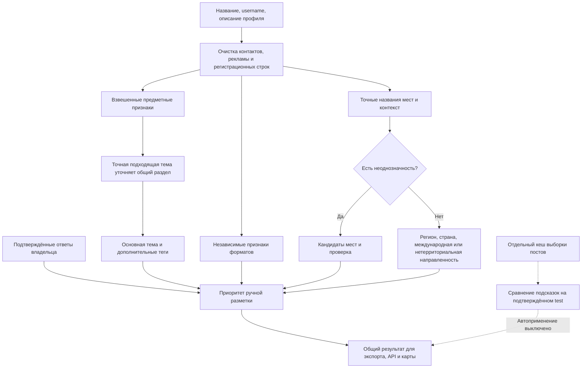

# Классификация V2

Версия схемы результата — **2**, версия таксономии — **6**. Классификация выполняется при экспорте, в HTTP API и в браузере по одним правилам. Telegram API и изменения структуры PostgreSQL для перехода не нужны.

## Что означает результат

| Измерение | Поля | Пример |
|---|---|---|
| Крупная предметная группа | `topic_group`, `topic_group_label` | Технологии |
| Основная тема | `subcategory`, `primary_category`, `topic_path` | Кибербезопасность |
| Дополнительные предметы | `secondary_topics` | Право, программирование |
| Форматы публикаций | `publication_formats` | Новости, аналитика |
| Территориальная направленность | `geography_scope`, `geography_regions`, `geography_country` | Мурманская область / RU |
| Подтверждённые места | `geography_places` | Город → субъект → страна, устойчивый ID |
| Основания и неопределённость | `topic_evidence`, `topic_candidates`, `geography_evidence`, `geography_candidates`, флаги проверки | Совпадение названия или конфликт одноимённых городов |

В конфигурации **18 групп, включая неуточнённую, и 55 тематик, включая неизвестную**. Все 22 прежних ID сохранены. Добавлены инвестиции, личные финансы, банки, налоги, предпринимательство, управление, продажи, HR, кибербезопасность, разработка ПО, гаджеты, телеком, космос, языки, семья, еда, красота, животные, дом/сад, психология, питание, фитнес, кино, музыка, книги, дизайн/мода, строительство, ЖКХ, логистика, авиация, право и социальная поддержка.

«Новости» отделены от предмета. Поле `general` теперь называется **«Общая повестка»**; новости программирования могут иметь тему «Разработка ПО» и формат «Новости». Форматы — новости, аналитика, обучение, авторское мнение, афиша, сообщество, предложения. Формат не заменяет основную тему. Крупные острова карты используют группы; выпадающий список позволяет выбрать целую группу или точную тему. Дополнительные темы участвуют в фильтрации только при включении соответствующей галочки.

Владелец может подтвердить только крупную группу: `expected_topic=other`, `expected_group=enterprise`. Результат сохранит `topic_granularity=group`; неподтверждённая узкая тема не придумывается.

## Алгоритм



Вес названия — 4, username — 3, описания — 2. Число совпадений одного поля ограничено тремя; повторение слов не наращивает вес. Короткие слова проверяются целыми токенами. Для точных выражений описания возможен порог 2; обычный порог — 3. Это веса правил, **не вероятности**. Подходящая узкая тема вытесняет свой общий раздел, а не несвязанные темы. Равные конкурирующие предметы остаются помеченными для проверки.

Приоритет тем: локальная поправка посетителя в браузере → подтверждённая разметка владельца → прежние ручные overrides → исходная специализированная рубрика с возможностью уточнения → признаки → помеченный для проверки общий fallback → неизвестно. Подтверждённую владельцем широкую рубрику автоматическое уточнение не меняет.

Контактные строки удаляются до анализа. География не используется как признак узкой темы. Для городских медиа сохранено отдельное объяснимое правило общей повестки по сочетанию города и новостного формата.

## География

| Значение `geography_scope` | Когда выбирать |
|---|---|
| `region` | Один регион или город с известным родительским регионом |
| `multi_region` | Подтверждённая направленность на несколько регионов |
| `country` | Явная страновая направленность; необходим код страны |
| `global` | Подтверждённая международная повестка |
| `nonlocal` | Содержательная тема без территориальной привязки |
| `unknown` | Недостаточно данных или есть конфликт |

`country=RU` во входном каталоге само по себе не доказывает общероссийскую направленность. Для `nonlocal` страна и регионы очищаются. Общие финансовые или предпринимательские каналы нельзя автоматически объявлять федеральными. Нетерриториальный характер назначается по положительным содержательным признакам, например рецептам или изучению языков, при отсутствии географических сигналов. «Налоги и экономика России» могут получить страновую направленность. В неоднозначном случае остаётся `unknown`.

Новый [справочник мест](../../config/geo_places.json) содержит 93 записи: города, точные формы названий, родительский субъект, страну и ID. Это стартовый проверяемый словарь, **не полный реестр всех населённых пунктов**. Прежние региональные псевдонимы остаются fallback. Для расширения добавляют отдельную запись с новым ID и родительским субъектом; одноимённым городам нужны разные ID.

Кировск без уточнения не превращается в Киров: в кандидатах остаются Мурманская и Ленинградская области. Явный `region_hint=Мурманская область` разрешает такой конфликт. Для Советска аналогично учитываются разные субъекты. Длинное точное название имеет приоритет над вложенным коротким. Биография автора, рекламные контакты и название улицы без подтверждённого города не считаются направленностью канала. Несколько противоречивых мест в профиле требуют проверки.

## Обновление существующей установки

1. В прежней форме **скачайте CSV с вашими 60 ответами** и сохраните копию. Обновите репозиторий. Состав, порядок и `group_id` исходной выборки на 200 каналов сохранены; повторный `prepare` для неё не требуется.
2. Откройте обновлённый `docs/review/classification-sample.html`. На том же адресе и в том же профиле браузера старая разметка переносится автоматически. При смене адреса/браузера нажмите **«Импорт CSV»** и выберите сохранённый файл.
3. Старые `general`, `business`, `tech`, `country` и остальные ID сохраняют свои ответы. Версия формы 1 не означает, что владелец проверял новые форматы. Непроверенные строки по-прежнему исключены из применения и обучения. Если профиль изменился, импортированная строка требует повторной проверки.
4. При желании уточните новые темы, форматы, крупную группу и причину ошибки. Для недостающей темы можно вписать предложение. Скачайте обновлённый CSV.
5. Примените подтверждённые ответы и пересоберите данные:

```bash
python scripts/classification_quality.py apply --review reports/classification-reviewed.csv
python scripts/classification_quality.py apply --review reports/classification-reviewed.csv --apply
python scripts/sync_topics.py
python main.py export
```

Первая команда показывает предпросмотр. Последняя требует вашей рабочей PostgreSQL. Если ручные ответы пока не применяются, для обновления правил достаточно последних двух команд. Новые миграции БД в V2 не добавляются. Перезапустите HTTP API, если он используется, и обновите страницу с очисткой кеша.

Применение сохраняет версию, проверенные поля, профиль и дату в `config/classification_labels.json`. Изменение названия или содержательного описания после проверки выставляет `classification_review_stale` и флаг проверки темы, сохраняя ручной ответ. Эта метка не означает автоматическую переклассификацию.

## Выборка постов без Telegram API

Эксперимент запускается отдельно и по умолчанию не используется картой:

```bash
python scripts/classification_quality.py sample-posts --channel breakingmash --pages 2 --limit 12
```

Публичные страницы `t.me/s/` читаются обычным HTTP. Бюджет — **1–3 страницы и 3–20 сохраняемых сообщений на канал**. Применяются общие сетевые ограничения парсера. Повторный запуск использует кеш до 24 часов; `--refresh` обновляет его. Кеш хранится в `reports/classification-samples/`, не коммитится и содержит тексты максимум по 4000 символов.

Исключаются короткие сообщения, точные текстовые повторы и явно маркированная реклама. Выборка распределяется между доступными датами. Если всё попало в один день, выставляется `low_diversity`: несколько страниц активного канала не считаются репрезентативными неделями. Разнообразие источников репостов и немаркированная реклама пока не определяются надёжно.

Подсказка требует минимум трёх согласованных сообщений, согласия не ниже 60% от уникальных пригодных постов и нескольких дат. Региональные упоминания показываются отдельно: новость о Москве не доказывает московскую направленность автора.

```bash
python scripts/classification_quality.py compare-posts --review reports/classification-reviewed.csv --output reports/posts-comparison.json
```

Сравнение использует только подтверждённый `test`, без ручных overrides оцениваемых каналов. Подсказка темы рассматривается лишь для результата, требующего проверки. Отчёт показывает одинаковый контрольный набор для метаданных и подсказок с постами, количество предложенных изменений, метрики тем/групп и географии. **Ничего не применяется:** `active=false`, `applied=0`.

Этот модуль не пишет в PostgreSQL, `posts` и `scrape_checkpoints`. Поэтому выборка не сдвигает новостной watermark и не создаёт разрыв между историей и последующим сбором новостей. Ошибка обновления не заменяет прежний кеш. Для закрытых каналов или недоступного публичного предпросмотра понадобится другой разрешённый источник.

## Обучение и оценка

[Существующий конвейер обучения](README.md#локальное-обучение) сохранён. Артефакт модели теперь привязан к версии таксономии; модель старой версии нужно заново обучить и оценить. Автоприменение модели выключено.

Владелец сообщил о 60 проверенных каналах, однако их CSV в доступном репозитории отсутствует. Эта реализация **не обучена на этих ответах**, а снижение числа неизвестных не выдаётся за доказанную точность. Нужен проверенный CSV, затем сравнение правил и модели на неизменном `test`. Для 55 тематик 60 примеров в любом случае недостаточно для надёжного обучения каждого класса.

Проверки реализации покрывают Python/JavaScript parity, точные подтемы и форматы, отрицательные географические примеры, одноимённые города, старый CSV и LocalStorage, подтверждение только группы, изменение профиля, ограничения/кеш выборки постов и отсутствие записи при сравнении. Тестовые 60 подтверждений проверяют миграцию формы, а не подменяют настоящую разметку владельца.
