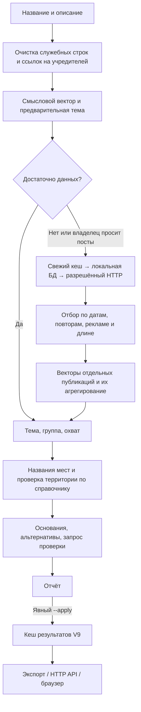

# V9: профиль, публикации и обучаемая смысловая модель

V9 — новый исполняемый конвейер, а не очередное расширение словаря ключевых слов.
Предобученный `intfloat/multilingual-e5-small` превращает тексты в смысловые векторы;
на подтверждённых ответах обучаются отдельные линейные классификаторы темы,
крупной группы и территориального охвата. Веса encoder не дообучаются.
Таксономия остаётся версии 8 (64 темы / 19 групп); это отдельная версия от
схемы результата `classification_version=9`.

## Поток данных



Ключевые слова не назначают тему V9. Сохраняются справочник допустимых тем,
проверенные владельцем ответы и географический справочник для связывания мест.
Прежний классификатор остаётся для сравнения и каналов, ещё не обработанных V9.
Экспорт и API не запускают ML или HTTP-запросы к Telegram: они читают готовый кеш.
Браузер сохраняет готовый результат V9, вместо повторного пересчёта по правилам.
Локальная правка посетителя и подтверждения владельца имеют приоритет.

## Когда нужны публикации

Посты запрашиваются, если содержательное описание короткое/бедное, профиль
официальный/корпоративный или содержит сведения об учредителях, предварительная
модель неуверенна либо владелец оставил просьбу проверить посты. Такие просьбы
из разметки сохраняются в метаданных модели. Комментарии и правильные ответы
не включаются во входные признаки.

Сначала проверяется кеш (до 24 часов), затем — локальные посты из БД,
если включено `--local-posts`, и затем HTTP, только при `--allow-http`.
За один запуск допускается не более `--max-http-channels` каналов, по 1–3 страницы
каждого. Применяются общий ограничитель частоты Telegram и паузы 429.
Одновременно с этим заданием не запускайте другие сетевые сборщики.

В работу идут 3–12 уникальных содержательных сообщений минимум за две даты.
Однодневная выборка, повторяющиеся тексты, короткие записи и явно маркированная
реклама исключаются. Нельзя гарантировать распознавание немаркированной рекламы
или всех репостов; разнообразие дат не доказывает репрезентативность истории.
Если выборки нет, причина сохраняется, канал остаётся требующим проверки.
Веса агрегирования заданы заранее: профиль 0.35, средний вектор постов 0.65,
затем нормализация. Это начальная исследовательская политика, не настроенная
по контрольным ответам. Каждая публикация также классифицируется отдельно,
чтобы выявлять смешанную повестку.

`posts`, новостной watermark и `scrape_checkpoints` не записываются.
Подключение CLI к БД использует read-only транзакцию.

## География

Тема бизнеса/технологий больше не принуждает V9 к `nonlocal`. Явный Пермский край
проверяется независимо от тематики. Начальная страна RU из каталога не считается
основанием для охвата. Китай в названии «Китай Инвест» связывается с CN, а не
с языком или аудиторией канала. Код CH означает Швейцарию.

На валидных географических ответах обучается отдельный классификатор охвата.
Он может предложить нетерриториальный характер, но не стирает явное место и
не придумывает регион. Страна/регион требуют географического основания;
упоминания одного места минимум в 3 и 60% пригодных постов показываются как
кандидат для проверки, а не автоматически объявляются охватом канала.
Сибирь фиксируется как кандидат-макротерритория, не подменяется случайным субъектом.
Проверка формы географической разметки пока требует конкретных субъектов:
макротерриториальная запись остаётся в очереди уточнения и не обучает head охвата.

## Установка и обучение

Из корня проекта в PowerShell создайте отдельное окружение Python 3.12:

```powershell
py -3.12 -m venv .venv-classification
.\.venv-classification\Scripts\Activate.ps1
python -m pip install -r requirements-classification.txt
```

Это необязательные зависимости с диапазонами версий, не lock. Для повторения
эксперимента сохраните `pip freeze`. При первом запуске скачивается encoder,
тексты не отправляются во внешний API. Вектора кешируются локально с ключом
из текста и ревизии модели. GPU не требуется; можно указать `--device cuda:0`.

Сохраните CSV владельца, например `reports/classification-reviewed-50.csv`.

```powershell
python scripts/classify_semantic.py train-pilot --review reports/classification-reviewed-50.csv --output models/semantic-v9-pilot.json --local-posts --allow-http --max-http-channels 12
```

Убедитесь, что `.env` указывает вашу `PG_DATABASE=tg_parser_atlas`.
Без `--local-posts` БД при обучении не подключается. Без `--allow-http` сеть
Telegram не используется, но первое скачивание encoder может потребовать интернет.

Выходы:

- `models/semantic-v9-pilot.json` — веса heads, ревизия encoder, поддержки классов,
  разбиение и результаты оценки, маршрутизация постов и хеши входных публикаций;
- `models/semantic-v9-pilot.report.json` — отчёт без весов;
- `models/semantic-v9-pilot.review-validation.json` — ошибки исходной разметки.

Каждая голова использует только подтверждённые ответы своего измерения:
запись с проверенной географией и непроверенной темой обучает только охват.
География валидируется отдельно, ошибка страны не исключает пригодную
тематическую метку. `other`, `other_group` и `unknown` не обучаются как
содержательные классы; такие контрольные ответы остаются в оценке. Одинаковые профили
считаются одним наблюдением; их split сохраняется, пересечение train/test
запрещено. Общие тексты постов train/test удаляются из контрольных признаков.
Поля ожидаемых ответов, username, рубрика каталога и комментарий не являются
признаками. Минимум запуска пилота — 10 train, 3 test и две темы в train;
это технический порог исследовательского режима, не достаточный объём разметки.
Старые требования `classification_quality.py train` не ослаблены.

Если CSV содержит `post_evidence`, тренер сначала использует этот замороженный
снимок, а не скачивает изменившиеся посты. Нужны минимум три разных содержательных
выдержки со ссылками и совпадающими ID сообщений того же канала. Реклама,
дубликаты и слишком короткие тексты исключаются. Старые формы не сохраняли даты:
это явно отмечается как `dates_unknown`, проверка разнообразия по датам для них
не заявляется. Это источник обучающих примеров владельца, а не свежий кеш для
классификации каталога. Новые формы сохраняют даты в заголовках выдержек.

У новых артефактов `version=2`, `post_text_limit=1000`: длина текста поста при
обучении и прогнозе совпадает с длиной сохранённой выдержки. Старые артефакты
без этого поля продолжают использовать прежние 4000 символов. При отсутствии
пригодного снимка действуют обычная маршрутизация и ограничения получения постов.

Все артефакты имеют `pilot_only=true`, `active=false`. В редких классах
и при неуверенной теме возможна только крупная группа. Оценки не калиброваны;
все модельные выводы пилота помечены для проверки. Неизвестные обучению
контрольные классы явно перечислены, их ошибки не скрываются из метрики.

## Проверка каталога и явная публикация

```powershell
python scripts/classify_semantic.py classify --database --model models/semantic-v9-pilot.json --limit 50 --output reports/semantic-v9/comparison.json --allow-http --max-http-channels 10
```

Результаты: JSON с профилями-основаниями, идентификаторами и текстами публикаций,
кандидатами темы/охвата, причинами проверки и состоянием получения постов;
рядом CSV для быстрого просмотра. Опция `--input web/data/channels.json` позволяет
работать со снимком; `--local-posts` тогда отдельно включает БД для чтения постов.
Для небольших партий есть `--offset`; максимум партии 500, по умолчанию 100.
При сохранении разметки или сравнительных отчётов используйте новые имена,
чтобы не заменять ранее полученные результаты.

Рядом с отчётом создаются `.review.csv` и `.review.html` стандартной формы владельца.
В HTML есть отдельный блок с текстами и ссылками использованных публикаций.
Подтверждения из скачанного CSV применяются обычным `classification_quality.py apply`;
непроверенные предложения подтверждёнными метками не становятся.

Обычный запуск не меняет карту. После просмотра результатов можно явно
публиковать **проверяемые предложения**:

```powershell
python scripts/classify_semantic.py classify --database --model models/semantic-v9-pilot.json --limit 50 --output reports/semantic-v9/comparison-approved.json --apply
python main.py export
```

При публикации модель не становится подтверждением владельца. Пока тема
требует проверки, текущая тема остаётся на карте, а ответ модели виден отдельно
в `semantic_proposal` и карточке. Это особенно важно для пилота с низкой точностью.
Неуверенное предложение охвата также не стирает текущую географию. Явная
подтверждённая профилем территория может применяться независимо от темы.
Флаги проверки сохраняются. `reports/semantic-v9/catalog.json` — отдельный накопительный кеш.
Экспорт/API применяют только результаты с совпадающим названием и очищенным
описанием. При изменении профиля результат считается устаревшим.
Результат, использовавший публикации, также перестаёт применяться спустя 24 часа
после получения выборки; исходный снимок сохраняется для аудита. Для отката
уберите этот кеш из рабочей папки и повторите export; БД не меняется.
Не публикуйте этот файл, encoder-кеши, CSV владельца и локальные веса в Git.

## Результат первого пилота

18 ноября 2026 проверены 50 тематических ответов владельца: 49 уникальных
профилей, 39 train и 10 test. На реальных публикациях получены пригодные выборки
12 каналов; HTTP ограничен 12 каналами и двумя страницами. Остальные запросы
постов не выдаются за выполненные.

Первое сравнение: точная тема 3/10, крупная группа 4/10; прежние правила на
тех же контрольных профилях совпали 10/10. Шесть контрольных тематик отсутствуют
в train, а большинство исправленных владельцем трудных случаев попали в train.
Для охвата: 5/9 у новой головы против 7/9 у прежних правил. Эти результаты не
доказывают качество на 3000 каналах и не являются основанием для автоматического
переназначения. Пятьдесят примеров позволили проверить исполняемый конвейер и
обнаружить дефицит обучающего покрытия, но не обучить надёжно 64 темы.

Далее нужны подтверждения недостающих классов и новые независимо проверенные
примеры с публикациями. Оригинальные ответы не исправляются по прогнозам модели.
Единственное исправление рабочей копии — CN вместо CH для «Китай Инвест» после
уточнения владельцем территории содержания; оригинал сохранён отдельно.

## Повторное обучение после второй проверки

Вторая партия содержит 49 подтверждённых тем и 50 географий; четыре канала
пересекаются с первой. Последняя проверка владельца заменяет прежний ответ,
но не меняет `split`. По уточнению владельца `agroprominform` остаётся без
точной темы до просмотра публикаций. Аэропорты и авиакомпании относятся
к «Авиации», разработка и производство самолётов — к «Авиастроению».
Остальные ответы не исправляются по догадке или прогнозу модели.

После объединения: 96 каналов с хотя бы одним подтверждённым измерением,
95 тематических ответов и 94 уникальных тематических профиля. Один дополнительный
профиль имеет только географическое подтверждение. Общий `train` — 73 профиля,
`test` — 22. Две старые географические записи требуют уточнения и не обучают охват.
Использованы выдержки из CSV для 19 каналов и пригодный кеш для восьми.
Остальным каналам не приписывается просмотр публикаций.

Диагностическое сравнение голов на одинаковых 22 контрольных профилях и
замороженных выдержках (не более 1000 символов):

| Выход головы | Предыдущая модель | Повторное обучение |
| --- | ---: | ---: |
| Точная тема | 10/22 | 15/22 |
| Крупная группа | 10/22 | 18/22 |
| Территориальный охват | 10/22 | 11/22 |

Это сравнение на общих признаках: предыдущая модель первоначально обучалась
с лимитом 4000 символов. Результаты не являются независимым итоговым тестом:
владелец уже анализировал контрольные ошибки. На этих же данных прежние правила
совпали с тематической разметкой в 11/22 случаях. Обучены 20 тематических классов;
`crypto`, `economics`, `marketing`, `taxes` отсутствуют в обучении, но встречаются
в контроле. Нельзя обобщать полученную точность на весь каталог.

Голова охвата не назначает страну или субъект. Полный географический конвейер
со справочником и ограничениями подтверждения совпал по охвату только в 8/22
случаях у обеих моделей. Нужна отдельная работа с географией и основаниями
в публикациях; увеличение тематической выборки само по себе эту задачу не решило.
Автоматическая замена классификации карты остаётся выключенной.

Для повторения используйте объединённый CSV с сохранёнными флагами и `split`,
а для результата задайте новое имя:

```powershell
python scripts/classify_semantic.py train-pilot --review reports/review-merged.csv --output models/semantic-v9-round2.json
python scripts/classify_semantic.py classify --database --model models/semantic-v9-round2.json --limit 50 --offset 100 --output reports/semantic-v9/round2-next50.json --allow-http --max-http-channels 50
```

Первый запуск читает сохранённые выдержки и пригодный локальный кеш без запросов
Telegram. Второй получает посты при необходимости; `offset` не исключает ранее
проверенные каналы автоматически. Выбирайте ещё не проверенную партию.
Следующая разметка должна целенаправленно закрыть недостающие и редкие классы,
а итоговый контроль — содержать новые каналы, не использованные для настройки.

## Если файлы из чата не скачиваются

Артефакты чата не нужны для локального повторного обучения. Сохраните свои
исходные проверенные CSV в `reports`. Объедините их от старого к новому:

```powershell
git switch frontend/atlas-redesign
git pull --ff-only
python scripts/classification_quality.py merge --review "reports/classification-reviewed (2).csv" --review "reports/classification-reviewed (3).csv" --unknown-topic agroprominform --country-correction divrentier=CN --output reports/classification-reviewed-merged.csv
python scripts/classify_semantic.py train-pilot --review reports/classification-reviewed-merged.csv --output models/semantic-v9-round2-local.json
```

Команда `merge` не использует БД, сеть или ML. Оригиналы сохраняются, неподтверждённые
предложения не становятся разметкой, прежний `split` канала сохраняется.
Поздний подтверждённый ответ заменяет ранний по соответствующему измерению.
Если профиль изменился, неподтверждённые заново прежние метки не переносятся
на новый текст. Пересечение одинаковых профилей между train/test запрещено.
Рядом создаётся `.merge-report.json` с изменениями и оставшимися ошибками.

Уточнения `--unknown-topic` и `--country-correction` выше отражают ответы владельца
для этой партии; для других данных используйте только свои явные исправления.
Обучение использует сохранённые выдержки CSV и доступный пригодный локальный кеш.
Без тех же кешированных постов и ревизии encoder локальная модель может отличаться
от модели из отчёта. Для проверки каталога укажите полученный файл модели в `--model`.
